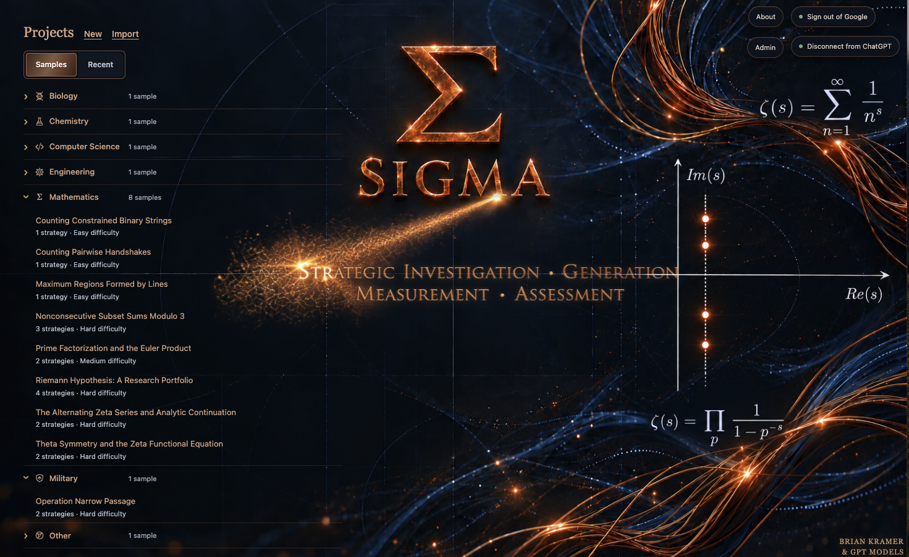
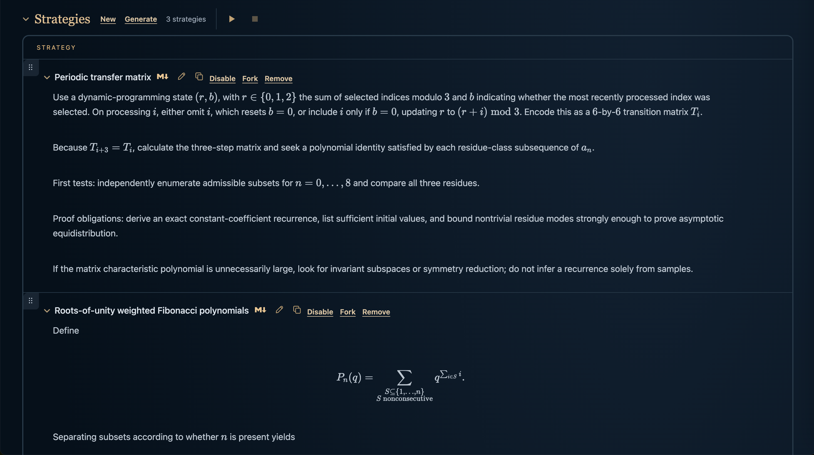

# SIGMA

**Strategy Investigation, Generation, Measurement & Assessment**

SIGMA is an experimental research workspace for investigating difficult questions through multiple approaches. It grew from an investigation into the Riemann Hypothesis and the idea that even an unsolved question should leave a useful, inspectable record of what was tried, what failed, and what remains unknown.

A project contains a question, candidate strategies, research sessions, and saved evidence. During a session, Investigator and Skeptic roles examine selected strategies in bounded exchanges. SIGMA records findings, objections, unresolved questions, and available computational results so a person can inspect and continue the investigation. Research can involve multiple strategies, with evidence carried forward between steps and sessions.

SIGMA does **not** establish that an answer is correct. Investigator and Skeptic currently use the same underlying model; their exchange is structured criticism, not independent validation. Model agreement and computational results are evidence to examine, not mathematical proof. The Riemann Hypothesis sample is an open problem, not a claimed solution. Whether persistent multi-agent investigation produces better-supported research than a simpler assistant given comparable resources remains unproven. See [Product Rationale](docs/PRODUCT_RATIONALE.md) and [Research Quality Charter](docs/RESEARCH_QUALITY_CHARTER.md).

## Using SIGMA

Create a project or copy a sample, write or generate strategies, and select strategies for a research session. Configure research rounds, a shared maximum number of agent turns, duration, and optional spending limits. A round is an Investigator–Skeptic exchange for one strategy; the turn limit bounds the total agent contributions across strategies. A session can be stopped and its saved record reviewed or resumed where supported. Review its Outcome alongside findings, objections, experiments, and open questions. Reports and exports preserve records for inspection; they do not verify conclusions.

SIGMA supports ordinary local use without a Google account, local testing of Google-authenticated access, and a separately configured hosted deployment. Hosted access, membership, and provider funding depend on the deployment's configuration; a local launch does not automatically connect to the hosted service.

## Example Outcome Papers

Four examples of the research SIGMA can preserve and communicate, spanning proven arguments, partial results, and carefully stated hypotheses. **These papers are experimental AI-generated work, not independently verified publications.** Each PDF is accompanied by its [TeX source](papers/).

| | |
| :--- | :--- |
| ** Mathematics · Easy · [Maximum Regions by Lines](papers/maximum-regions.pdf)**<br><br>A complete geometric argument for the greatest number of regions formed by straight lines, including an explicit construction attaining the bound. | ** Mathematics · Hard · [Nonconsecutive Subset Sums](papers/nonconsecutive-subset-sums.pdf)**<br><br>Exact enumeration and a corrected combinatorial identity, with an unproved recurrence and density limit clearly identified. TeX formatting was manually repaired for this example. |
| ** Biology · Hard · [Xenopus Tail Regeneration](papers/xenopus-tail-regeneration.pdf)**<br><br>A testable hypothesis about the developmental loss of regeneration competence, distinguishing what existing data might show from what remains untested. | ** Military planning · Hard · [Operation Narrow Passage](papers/operation-narrow-passage.pdf)**<br><br>Conditional analysis of a fictional maritime crisis: competing objectives, uncertainty, and why no response can be guaranteed to succeed. |

### Screenshots

**Home** — start an investigation or explore sample projects.



**Strategies** — compare approaches to a mathematical question and preserve their outstanding obligations.



## Run locally

Requires **macOS or Linux**, **Python 3.11+**, **[uv](https://docs.astral.sh/uv/)**, and **Node.js 20.19+** with npm. From a terminal:

```sh
git clone https://github.com/bkramerext/sigma.git
cd sigma
./sigma setup
./sigma start --navigate
```

If the browser does not open, visit **http://127.0.0.1:5173**. Press **Ctrl+C** in the launcher terminal to stop. The default project directory is `projects/`; set `SIGMA_PROJECTS_ROOT` to an **existing absolute directory** before starting to store projects elsewhere.

You can create projects and strategies without an AI connection. To use AI research, choose **Connect AI** for a ChatGPT connection (subject to account and provider limits), or set a separately billed `OPENAI_API_KEY` in the server environment or ignored `.env` and restart. **ChatGPT connection and Google sign-in are different:** the former supplies access to an inference provider; the latter identifies a SIGMA user for account and membership controls. Provider usage and billing are not included with a local installation.

`./sigma setup` installs the locked Python development environment with `uv sync --locked --group dev` and the frontend dependencies with `npm ci`. Setup and local startup were verified in a fresh Git worktree on the existing macOS 14.6 Apple Silicon host (not on a clean machine); the frontend and local API both returned ready responses. This does not establish behavior on every macOS/Linux distribution. See [Getting Started](docs/GETTING_STARTED.md) for troubleshooting.

## Optional: test Google sign-in locally

Google authentication is **not required** for ordinary local use. To exercise the authenticated account flow, create a Google OAuth **web** client with:

- Authorized JavaScript origin: `http://127.0.0.1:5173`
- Authorized redirect URI: `http://127.0.0.1:5173/api/cloud-auth/callback`

Put `GOOGLE_OIDC_CLIENT_ID` and `GOOGLE_OIDC_CLIENT_SECRET` in the ignored `.env` (or the server environment), then start with an explicitly configured administrator contact:

```sh
export SIGMA_CLOUD_ADMIN_CONTACT_EMAIL="you@gmail.com"
./sigma start --navigate --signin
```

Sign in with the Google account matching `SIGMA_CLOUD_ADMIN_CONTACT_EMAIL` to establish the local administrator. Other users require membership grants. Local authentication state is stored under `~/.sigma/local-cloud-auth`; keep OAuth secrets out of version control. Use a separate browser profile when testing multiple accounts.

This is a **local authentication test**, not a hosted deployment. For hosted configuration and administrator operations, see [Cloud Deployment](docs/CLOUD_DEPLOYMENT.md). For a provider-free UI simulation of membership, allowances, and errors, see [Local Mock Authentication](docs/LOCAL_MOCK_AUTH.md). Mock identities are not real Google accounts and mock research is not AI inference.

## Optional: scientific computation

Build the optional Python execution sandbox with:

```sh
docker build -t sigma-research-python:0.1 sandbox-poc
```

Docker and the sandbox image are **not required** for the basic local UI. See [Python Execution](docs/RESEARCH_PYTHON_EXECUTION.md) and [Sage Execution](docs/SAGE_EXECUTION.md) for isolation assumptions, setup, and limitations.

## Documentation

- [Getting Started](docs/GETTING_STARTED.md) — workflows, setup, and troubleshooting
- [Journal](docs/JOURNAL.md) — day-by-day story of building SIGMA
- [Product Rationale](docs/PRODUCT_RATIONALE.md) and [Research Quality Charter](docs/RESEARCH_QUALITY_CHARTER.md) — research goals and evidence standards
- [Cloud Deployment](docs/CLOUD_DEPLOYMENT.md) and [Deployment Runbook](docs/DEPLOYMENT_RUNBOOK.md) — hosted configuration and release procedure
- [Local Mock Authentication](docs/LOCAL_MOCK_AUTH.md) — developer-only account and provider-state simulation
- [Software Factory](docs/SOFTWARE_FACTORY.md) and [WOLF](WOLF.md) — human-directed development process

Run `./sigma --help` for commands or `./sigma test` for local checks.
