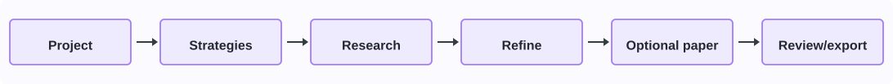

# SIGMA

**Strategy Investigation, Generation, Measurement & Assessment**

**[See it in action](https://sigma-research.duckdns.org/)**

SIGMA is a **multi-user, collaborative research workspace** for exploring difficult questions with AI. Multiple researchers can work on **the same shared project**, contributing to its strategies, research sessions, findings, and papers rather than exchanging disconnected copies. Investigator and Skeptic agents examine competing approaches while SIGMA preserves evidence, objections, and open questions for the whole team. Research remains cost-conscious and inspectable.

This effort grew from an investigation into the Riemann Hypothesis and the idea that even an unsolved question should leave a useful, inspectable record of what was tried, what failed, and what remains unknown.

A SIGMA project contains a question, candidate strategies, research sessions, and saved evidence. During a session, Investigator and Skeptic roles examine selected strategies in bounded exchanges. SIGMA records findings, objections, unresolved questions, and available computational results so a person can inspect and continue the investigation. Research can involve multiple strategies, with evidence carried forward between steps and sessions.

SIGMA does **not** establish that an answer is correct. Investigator and Skeptic currently use the same underlying model; their exchange is structured criticism, not independent validation. Model agreement and computational results are evidence to examine, not mathematical proof. The Riemann Hypothesis sample is an open problem, not a claimed solution. Whether persistent multi-agent investigation produces better-supported research than a simpler assistant given comparable resources remains unproven. See [Product Rationale](docs/PRODUCT_RATIONALE.md) and [Research Quality Charter](docs/RESEARCH_QUALITY_CHARTER.md).

## Using SIGMA

Create a project or start from a sample, then invite collaborators to investigate the question together. Everyone authorized for a shared project works with the **same ongoing research record**—strategies, sessions, evidence, and papers—across their own signed-in accounts. You can also work privately. The overview below shows how SIGMA preserves findings and can optionally develop saved research into a paper. For session controls and limits, see [Connect AI and investigate](docs/GETTING_STARTED.md#connect-ai-and-investigate).

## Workflow

<p align="center"></p>

- **Create a project:** Choose a subject or sample and frame the question.
- **Collaborate on the same project:** Add other Google-account users in Project Settings → Collaborators. They see the shared project in **My Work** and contribute to its research rather than working on separate copies.
- **Explore strategies:** Develop approaches to the question and select which to investigate.
- **Run research:** Investigator and Skeptic examine selected strategies; SIGMA saves findings, evidence, objections, and open questions.
- **Review and refine:** Inspect sessions, the Outcome, and Current Understanding. Revise strategies or run more sessions when useful; research can be iterative.
- **Draft a paper (optional):** SIGMA can synthesize saved research into an academic draft. A draft is not proof or independent verification.
- **Review and export:** Export research records and reports for inspection or sharing, with no paper required. If you create a paper, review its claims, evidence, citations, and limitations before exporting PDF or TeX. You decide whether and where to share or publish a paper; SIGMA does not submit papers to journals.

## Collaborate with other researchers

SIGMA supports **multiple people working on one project**. A project owner can invite collaborators by their Google account email addresses in **Project Settings → Collaborators**. Invited users sign in with their own accounts and find the shared project under **My Work**, marked with a collaboration icon. An invitation email provides a direct link to the project when a public SIGMA URL is configured.

A collaborator works in the owner's shared project, not a fork or emailed snapshot. Authorized participants can inspect and build upon the same project question, strategies, research history, and generated papers. Changes are attributed to the owner or collaborator who made them. Project changes are saved as they are made; returning to the project shows its latest saved state.

Access is controlled by verified Google sign-in and project membership. The owner can remove any collaborator; a collaborator can remove only collaborators they added. SIGMA checks revisions to reject conflicting or stale edits, and coordinates execution so simultaneous users do not run conflicting research or paper work on the same project.

**Private projects are still supported.** You can use SIGMA locally without Google sign-in; authenticated collaboration requires the local or hosted deployment to be configured for Google-based accounts. Sharing access to a project is different from exporting or emailing a copy.

SIGMA supports ordinary local use without a Google account, local testing of Google-authenticated access, and a separately configured hosted deployment. Hosted access, membership, and provider funding depend on the deployment's configuration; a local launch does not automatically connect to the hosted service.

## Example Outcome Papers

These papers are **proofs of concept**, demonstrating what SIGMA can produce today rather than its intended final quality. Research and paper authoring remain works in progress; further improvements to SIGMA are expected to improve the clarity, rigor, and presentation of future papers. **These examples are experimental AI-generated work, not independently verified publications.** Eight papers are available now, including the six reference research papers, Maximum Regions by Lines, and Operation Narrow Passage; a ninth literature example is coming soon. Each available PDF is accompanied by its TeX source, with both archived under `papers/`.

<table>
<tr>
<td width="33%" valign="top"><p><sub></sub> <strong>Mathematics · Easy</strong></p><p><strong><a href="https://raw.githubusercontent.com/bkramerext/sigma/main/papers/maximum-regions.pdf">Maximum Regions by Lines</a></strong> · <a href="https://raw.githubusercontent.com/bkramerext/sigma/main/papers/maximum-regions.tex">TeX</a></p><p>A geometric proof of the maximum regions formed by lines.</p></td>
<td width="33%" valign="top"><p><sub></sub> <strong>Mathematics · Hard</strong></p><p><strong><a href="https://raw.githubusercontent.com/bkramerext/sigma/main/papers/nonconsecutive-subset-sums-modulo-3-golden5.pdf">Nonconsecutive Subset Sums Modulo 3</a></strong> · <a href="https://raw.githubusercontent.com/bkramerext/sigma/main/papers/nonconsecutive-subset-sums-modulo-3-golden5.tex">TeX</a></p><p>Exact counts and a corrected identity; the recurrence remains unproved.</p></td>
<td width="34%" valign="top"><p><sub></sub> <strong>Physics · Hard</strong></p><p><strong><a href="https://raw.githubusercontent.com/bkramerext/sigma/main/papers/warp-drive-design-golden5.pdf">Warp Drive Design</a></strong> · <a href="https://raw.githubusercontent.com/bkramerext/sigma/main/papers/warp-drive-design-golden5.tex">TeX</a> · <a href="https://raw.githubusercontent.com/bkramerext/sigma/main/assets/warp_drive_q_a_corrected.png">Research Q/A example</a></p><p>General-relativistic shift-bubble analysis, without claiming practical propulsion.</p></td>
</tr>
<tr>
<td width="33%" valign="top"><p><sub></sub> <strong>AI systems · Hard</strong></p><p><strong><a href="https://raw.githubusercontent.com/bkramerext/sigma/main/papers/agent-reliability-v1-golden5.pdf">Agent Reliability v1</a></strong> · <a href="https://raw.githubusercontent.com/bkramerext/sigma/main/papers/agent-reliability-v1-golden5.tex">TeX</a></p><p>Distinguishing real agent actions from convincing reports, and testing recovery guarantees.</p></td>
<td width="33%" valign="top"><p><sub></sub> <strong>AI systems · Hard</strong></p><p><strong><a href="https://raw.githubusercontent.com/bkramerext/sigma/main/papers/sovereign-ai-federation-v2-golden5.pdf">Sovereign AI Federation v2</a></strong> · <a href="https://raw.githubusercontent.com/bkramerext/sigma/main/papers/sovereign-ai-federation-v2-golden5.tex">TeX</a></p><p>Sharing university AI capacity while preserving data authority and spending controls.</p></td>
<td width="34%" valign="top"><p><sub></sub> <strong>Physics · Hard</strong></p><p><strong><a href="https://raw.githubusercontent.com/bkramerext/sigma/main/papers/when-does-qubit-decoherence-require-a-non-markovian-model-v1-v1.pdf">Qubit Decoherence and Non-Markovian Models</a></strong> · <a href="https://raw.githubusercontent.com/bkramerext/sigma/main/papers/when-does-qubit-decoherence-require-a-non-markovian-model-v1-v1.tex">TeX</a></p><p>When coherence decay can distinguish memory effects from alternatives.</p></td>
</tr>
<tr>
<td width="33%" valign="top"><p><sub></sub> <strong>Biology · Hard</strong></p><p><strong><a href="https://raw.githubusercontent.com/bkramerext/sigma/main/papers/xenopus-tadpoles-v9-golden5.pdf">Xenopus Tadpoles</a></strong> · <a href="https://raw.githubusercontent.com/bkramerext/sigma/main/papers/xenopus-tadpoles-v9-golden5.tex">TeX</a></p><p>Why tail regeneration fades during development; evidence and open questions.</p></td>
<td width="33%" valign="top"><p><sub></sub> <strong>Military planning · Hard</strong></p><p><strong><a href="https://raw.githubusercontent.com/bkramerext/sigma/main/papers/operation-narrow-passage.pdf">Operation Narrow Passage</a></strong> · <a href="https://raw.githubusercontent.com/bkramerext/sigma/main/papers/operation-narrow-passage.tex">TeX</a></p><p>Competing objectives and uncertainty in a fictional crisis.</p></td>
<td width="34%" valign="top"><p><sub></sub> <strong>Literature · Hard</strong></p><p><strong>The Crucible: Early American Culture and Authorship</strong> · <em>Coming soon...</em></p><p>Miller’s Salem drama as a lens on early American culture, his influences, and artistic intentions.</p></td>
</tr>
</table>

## Screenshots

**Home** — start an investigation or explore sample projects.


**Strategies** — compare approaches to a mathematical question and preserve their outstanding obligations.


## Research loop

A research **session** runs selected strategies through **rounds** of Investigator/Skeptic **turns**. Each turn pairs one Investigator proposal with one Skeptic critique; later turns and rounds can use selected earlier findings and objections. The default configuration allows up to **54 agent calls** across 3 rounds, 3 turns per strategy per round, and 3 strategies. See [Information Flow](docs/INFORMATION_FLOW.md) for how work and evidence move between turns, rounds, and strategies—and how Session Outcome and Current Understanding summarize the results.

## Run locally

Requires **macOS or Linux**, **Python 3.11+**, **[uv](https://docs.astral.sh/uv/)**, and **Node.js 20.19+** with npm. SIGMA uses Zstandard-compressed project bundles; `./sigma setup` installs `zstd` via Homebrew (macOS) or apt (Debian/Ubuntu Linux) when it is missing. From a terminal:

```sh
git clone https://github.com/bkramerext/sigma.git
cd sigma
./sigma setup
./sigma start --navigate
```

If the browser does not open, visit **http://127.0.0.1:5173**. Press **Ctrl+C** in the launcher terminal to stop. The default project directory is `projects/`; set `SIGMA_PROJECTS_ROOT` to an **existing absolute directory** before starting to store projects elsewhere.

You can create projects and strategies without an AI connection. To use AI research, choose **Connect AI** for a ChatGPT connection (subject to account and provider limits), or set a separately billed `OPENAI_API_KEY` in the server environment or ignored `.env` and restart. **ChatGPT connection and Google sign-in are different:** the former supplies access to an inference provider; the latter identifies a SIGMA user for account and membership controls. Provider usage and billing are not included with a local installation.

`./sigma setup` installs the locked Python development environment with `uv sync --locked --group dev` and the frontend dependencies with `npm ci`. Setup and local startup were verified in a fresh Git worktree on the existing macOS 14.6 Apple Silicon host (not on a clean machine); the frontend and local API both returned ready responses. This does not establish behavior on every macOS/Linux distribution. See [Getting Started](docs/GETTING_STARTED.md) for troubleshooting.

## Optional: local feedback and Email Project (Gmail or SMTP)

Local SIGMA can send **Send Feedback** notifications and **Email Project** messages (including JSON, PDF, and LaTeX attachments).

**Gmail through Google sign-in (recommended for localhost):** Set `GOOGLE_OIDC_CLIENT_ID` and `GOOGLE_OIDC_CLIENT_SECRET` (or its `_FILE` form) in this checkout's ignored `.env`. Use the **same local Google web OAuth client** as SIGMA's UI, with `http://127.0.0.1:5173/api/cloud-auth/callback` as an authorized redirect URI. Then run:

```sh
./sigma send_feedback "hello world" --transport gmail
./sigma send_feedback "hello world" --transport gmail --attach ./path/to/file.pdf
```

Use `--attach PATH` to send a single local file as a MIME attachment with a feedback test message. Both Gmail API and SMTP are supported. Relative, absolute, and `~/` paths work. Files over 18 MB, missing files, and unreadable files are rejected before opening Google authorization or contacting the mail provider. The CLI does not persist an application Feedback record, and the browser Feedback endpoint is unchanged.

The command opens your default browser for Google's explicit **Gmail Send** permission, captures the OAuth callback using a temporary localhost listener, stores an account-bound grant privately under `~/.sigma/local-cloud-auth/gmail-send-token.json`, and sends one feedback test message. It does **not** start the SIGMA UI, need a separate terminal, or read browser session cookies. It verifies the Google account you select through the OAuth identity token and uses that verified address as the feedback contact; `SIGMA_CLOUD_ADMIN_CONTACT_EMAIL` is the test recipient and can be a different mailbox. The command reuses an existing matching grant on later calls. Add `--reauthorize` if you want to choose a different sending account. If port 5173 is free, the CLI listens for the Google callback itself. If your **updated local SIGMA UI is already running** on that port, the CLI uses its local-only callback handoff instead; you do not need to navigate through the UI or stop it. An older running SIGMA process without the new handoff must be restarted once, or shut down with `./sigma shutdown`. An unrelated process on the port is never stopped or trusted. Production is not modified.

Gmail's `gmail.send` scope may require app verification or tester authorization. An External Testing OAuth app may issue a refresh token that expires after seven days. If consent is blocked, resolve it in the **local OAuth project**, not the production deployment.

**SMTP alternative:** Local email can also use SMTP. **Google OAuth branding verification is not required for SMTP.** The sender needs an SMTP credential, such as a Gmail **app password**, not your normal Google-account password. Gmail accounts must meet Google's eligibility requirements for app passwords.

*Needs a guinea pig to prove local setup works. Will pay with lettuce.*

Keep the credential outside the repository. For an existing local setup, check whether the password file already exists:

```sh
ls -l ~/.config/sigma/smtp-password
```

Do **not** print or paste its contents. A private password file should be accessible only to your user (for example, permissions `600`). If you need to create it, use a protected local file containing only the app password. The example path is a convention, **not** a password that SIGMA creates automatically.

Configure the local checkout's ignored `.env` file (or export equivalent shell variables):

```dotenv
SIGMA_EMAIL_SMTP_HOST=smtp.gmail.com
SIGMA_EMAIL_SMTP_PORT=587
SIGMA_EMAIL_SMTP_USERNAME=your-sending-account@gmail.com
SIGMA_EMAIL_SMTP_PASSWORD_FILE=/absolute/path/to/.config/sigma/smtp-password
SIGMA_CLOUD_ADMIN_CONTACT_EMAIL=your-google-sign-in@gmail.com
```

Replace the example addresses and file path with your own; **the password-file path must be absolute**. In `.env`, `~` and `$HOME` are **not expanded**, so use your real home-directory path. The SMTP username is the account that sends mail. The administrator contact is the local sign-in/admin address; these may be different.

From the checkout, test the SMTP transport directly (without requiring a running browser or sending a feedback database record):

```sh
./sigma send_feedback "hello world" --transport smtp
```

The diagnostic prints which transport was selected, whether SMTP credentials are configured, and whether the mail provider accepted delivery; it never prints the password. It sends the test message to `SIGMA_CLOUD_ADMIN_CONTACT_EMAIL`. SMTP testing uses the configured local contact address, while Gmail OAuth testing uses the Google-verified sender as its contact. Normal browser **Send Feedback** uses the authenticated Google account's email as its contact address, or an optional unverified contact address for guests.

If you previously configured `SIGMA_GMAIL_TOKEN_FILE`, `SIGMA_EMAIL_GMAIL_TOKEN_FILE`, or `SIGMA_INVITATION_GMAIL_TOKEN_FILE`, ordinary feedback sending prefers the Gmail API path instead of SMTP. The `--transport smtp` flag overrides this **for the CLI invocation only**; to use SMTP in the browser, remove/disable the Gmail token-file setting from the local backend environment and restart `./sigma start`. Environment variables exported in your shell override the ignored `.env`, even if empty. Never commit credentials or copy the protected password file into Git.

## Optional: test Google sign-in locally

Google authentication is **not required** for ordinary local use. To exercise the authenticated account flow, create a Google OAuth **web** client with:

- Authorized JavaScript origin: `http://127.0.0.1:5173`
- Authorized redirect URI: `http://127.0.0.1:5173/api/cloud-auth/callback`

Put `GOOGLE_OIDC_CLIENT_ID` (the Google OAuth application's identifier) and `GOOGLE_OIDC_CLIENT_SECRET` (its server-side credential) in the checkout-root `.env` or the server environment. **Each Git checkout/worktree needs its own `.env`**: Git ignores this file, so it will not follow you into a new checkout. If another local checkout already has working credentials, copy its `.env` to this checkout and restrict access with `chmod 600 .env`. Never commit or share the secrets. Exported shell variables take precedence over `.env`, even when exported as empty strings.

Set your administrator contact in `.env` or export it, then launch SIGMA:

```sh
export SIGMA_CLOUD_ADMIN_CONTACT_EMAIL="you@gmail.com"
./sigma start --navigate
```

Use the **Google Sign In** pill to choose a real Google account. **Do not pass `--signin` for this test**: that option now supplies a local administrator identity without performing Google OAuth. Sign in with the account matching `SIGMA_CLOUD_ADMIN_CONTACT_EMAIL` to establish the local administrator; other accounts require membership grants. Local authentication state is stored under `~/.sigma/local-cloud-auth`. Use separate browser profiles when testing multiple accounts.

This is a **local authentication test**, not a hosted deployment. For hosted configuration and administrator operations, see [Cloud Deployment](docs/CLOUD_DEPLOYMENT.md). For a provider-free UI simulation of membership, allowances, and errors, see [Local Mock Authentication](docs/LOCAL_MOCK_AUTH.md). Mock identities are not real Google accounts and mock research is not AI inference.

## Optional: scientific computation

Build the optional Python execution sandbox with:

```sh
docker build -t sigma-research-python:0.1 sandbox-poc
```

Docker and the sandbox image are **not required** for the basic local UI. See [Python Execution](docs/RESEARCH_PYTHON_EXECUTION.md) and [Sage Execution](docs/SAGE_EXECUTION.md) for isolation assumptions, setup, and limitations.

## Documentation

- [Getting Started](docs/GETTING_STARTED.md) — workflows, setup, and troubleshooting
- [Journal](docs/JOURNAL.md) — day-by-day story of building SIGMA
- [Product Rationale](docs/PRODUCT_RATIONALE.md) and [Research Quality Charter](docs/RESEARCH_QUALITY_CHARTER.md) — research goals and evidence standards
- [Research and Writing Reference Scores](docs/REFERENCE_SCORES.md) — all 28 curated reference links, selection scores, and remaining limitations; see [Reference Curation Audit](docs/REFERENCE_CURATION.md) for detailed assessments
- [Cloud Deployment](docs/CLOUD_DEPLOYMENT.md) and [Deployment Runbook](docs/DEPLOYMENT_RUNBOOK.md) — hosted configuration and release procedure
- [Local Mock Authentication](docs/LOCAL_MOCK_AUTH.md) — developer-only account and provider-state simulation
- [Software Factory](docs/SOFTWARE_FACTORY.md) and [WOLF](WOLF.md) — human-directed development process

Run `./sigma --help` for commands or `./sigma test` for local checks.

Release notes: [v0.1.6 Initial Preview and v0.1.7 Reliability and Access Improvements](docs/RELEASE_NOTES.md).
