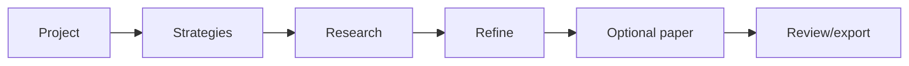
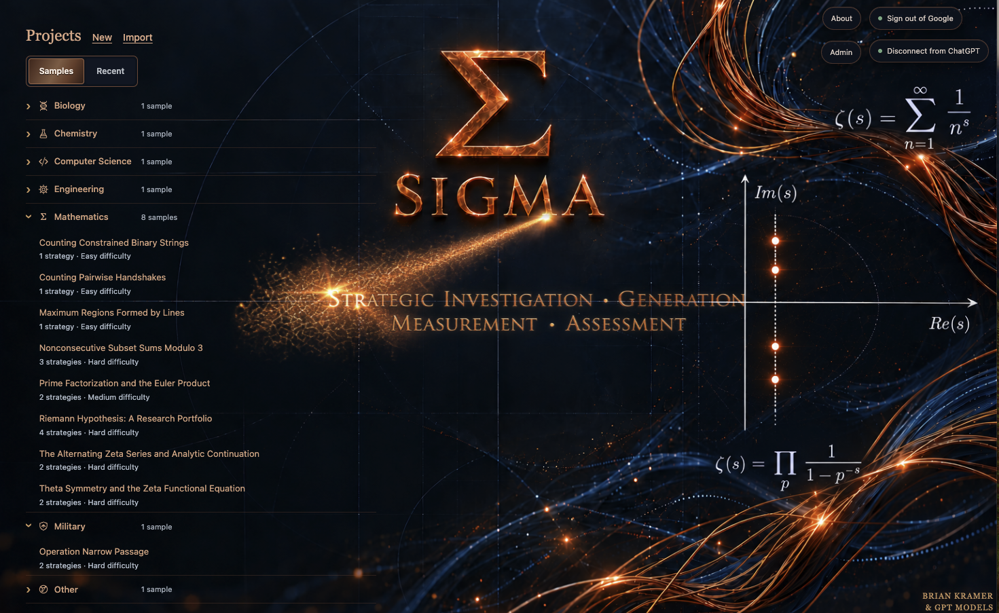
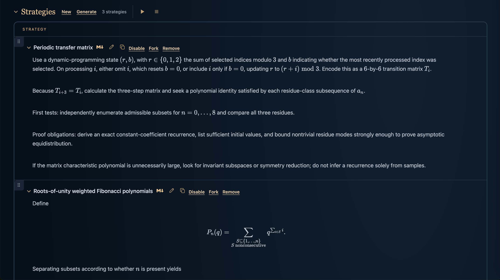

# SIGMA

**Strategy Investigation, Generation, Measurement & Assessment**

**[Open Hosted SIGMA →](https://sigma-research.duckdns.org/)**

SIGMA is an experimental research workspace for investigating difficult questions through multiple approaches. It grew from an investigation into the Riemann Hypothesis and the idea that even an unsolved question should leave a useful, inspectable record of what was tried, what failed, and what remains unknown.

A project contains a question, candidate strategies, research sessions, and saved evidence. During a session, Investigator and Skeptic roles examine selected strategies in bounded exchanges. SIGMA records findings, objections, unresolved questions, and available computational results so a person can inspect and continue the investigation. Research can involve multiple strategies, with evidence carried forward between steps and sessions.

SIGMA does **not** establish that an answer is correct. Investigator and Skeptic currently use the same underlying model; their exchange is structured criticism, not independent validation. Model agreement and computational results are evidence to examine, not mathematical proof. The Riemann Hypothesis sample is an open problem, not a claimed solution. Whether persistent multi-agent investigation produces better-supported research than a simpler assistant given comparable resources remains unproven. See [Product Rationale](docs/PRODUCT_RATIONALE.md) and [Research Quality Charter](docs/RESEARCH_QUALITY_CHARTER.md).

## Using SIGMA

Create a project or sample, then choose strategies to investigate. The overview below shows how SIGMA preserves findings for review and how you can optionally develop saved research into a paper. For session controls and limits, see [Connect AI and investigate](docs/GETTING_STARTED.md#connect-ai-and-investigate).

### Workflow



- **Create a project:** Choose a subject or sample and frame the question.
- **Explore strategies:** Develop approaches to the question and select which to investigate.
- **Run research:** Investigator and Skeptic examine selected strategies; SIGMA saves findings, evidence, objections, and open questions.
- **Review and refine:** Inspect sessions, the Outcome, and Current Understanding. Revise strategies or run more sessions when useful; research can be iterative.
- **Draft a paper (optional):** SIGMA can synthesize saved research into an academic draft. A draft is not proof or independent verification.
- **Review and export:** Export research records and reports for inspection or sharing, with no paper required. If you create a paper, review its claims, evidence, citations, and limitations before exporting PDF or TeX. You decide whether and where to share or publish a paper; SIGMA does not submit papers to journals.

SIGMA supports ordinary local use without a Google account, local testing of Google-authenticated access, and a separately configured hosted deployment. Hosted access, membership, and provider funding depend on the deployment's configuration; a local launch does not automatically connect to the hosted service.

## Example Outcome Papers

These papers are **proofs of concept**, demonstrating what SIGMA can produce today rather than its intended final quality. Research and paper authoring remain works in progress; further improvements to SIGMA are expected to improve the clarity, rigor, and presentation of future papers. **These examples are experimental AI-generated work, not independently verified publications.** The eight examples below include the six reference research papers, Maximum Regions by Lines, and Operation Narrow Passage. Each PDF is accompanied by its TeX source, with both archived under `papers/`.

<table>
<tr>
<td width="50%" valign="top"><p><sub></sub> <strong>Mathematics · Easy</strong></p><p><strong><a href="papers/maximum-regions.pdf">Maximum Regions by Lines</a></strong> · <a href="papers/maximum-regions.tex">TeX</a></p><p>A geometric proof of the maximum number of regions formed by lines.</p></td>
<td width="50%" valign="top"><p><sub></sub> <strong>Mathematics · Hard</strong></p><p><strong><a href="papers/nonconsecutive-subset-sums-modulo-3-golden5.pdf">Nonconsecutive Subset Sums Modulo 3</a></strong> · <a href="papers/nonconsecutive-subset-sums-modulo-3-golden5.tex">TeX</a></p><p>Exact counts and a corrected identity; the proposed recurrence remains unproved.</p></td>
</tr>
<tr>
<td width="50%" valign="top"><p><sub></sub> <strong>AI systems · Hard</strong></p><p><strong><a href="papers/agent-reliability-v1-golden5.pdf">Agent Reliability v1</a></strong> · <a href="papers/agent-reliability-v1-golden5.tex">TeX</a></p><p>Distinguishing successful external actions from convincing agent completion reports, and evaluating recovery guarantees.</p></td>
<td width="50%" valign="top"><p><sub></sub> <strong>AI systems · Hard</strong></p><p><strong><a href="papers/sovereign-ai-federation-v2-golden5.pdf">Sovereign AI Federation v2</a></strong> · <a href="papers/sovereign-ai-federation-v2-golden5.tex">TeX</a></p><p>Assessing whether universities can share AI capacity while retaining data authority and spending controls.</p></td>
</tr>

<tr>
<td width="50%" valign="top"><p><sub></sub> <strong>Biology · Hard</strong></p><p><strong><a href="papers/xenopus-tadpoles-v9-golden5.pdf">Xenopus Tadpoles</a></strong> · <a href="papers/xenopus-tadpoles-v9-golden5.tex">TeX</a></p><p>Research on the developmental loss of tail regeneration competence, its evidence and unresolved questions.</p></td>
<td width="50%" valign="top"><p><sub></sub> <strong>Military planning · Hard</strong></p><p><strong><a href="papers/operation-narrow-passage.pdf">Operation Narrow Passage</a></strong> · <a href="papers/operation-narrow-passage.tex">TeX</a></p><p>Conditional analysis of a fictional crisis, competing objectives, and uncertainty.</p></td>
</tr>
<tr>
<td width="50%" valign="top"><p><sub></sub> <strong>Physics · Hard</strong></p><p><strong><a href="papers/warp-drive-design-golden5.pdf">Warp Drive Design</a></strong> · <a href="papers/warp-drive-design-golden5.tex">TeX</a></p><p>A general-relativistic shift-bubble analysis, without claiming practical propulsion.</p></td>
<td width="50%" valign="top"><p><sub></sub> <strong>Physics · Hard</strong></p><p><strong><a href="papers/when-does-qubit-decoherence-require-a-non-markovian-model-v1-v1.pdf">Qubit Decoherence and Non-Markovian Models</a></strong> · <a href="papers/when-does-qubit-decoherence-require-a-non-markovian-model-v1-v1.tex">TeX</a></p><p>When observed coherence decay can distinguish memory effects from alternatives.</p></td>
</tr>
</table>

### Screenshots

**Home** — start an investigation or explore sample projects.



**Strategies** — compare approaches to a mathematical question and preserve their outstanding obligations.



## Research loop

A session follows **research rounds → turns per strategy → Investigator call, then Skeptic call**. One turn is an Investigator/Skeptic pair; each round allows **3 turns per strategy** by default. Strategies can advance concurrently, but the two calls within a turn run in order.

With three selected strategies, the default ceiling is **3 rounds × 3 turns × 3 strategies × 2 calls = 54 agent calls**—a maximum, not a promise of completion. Saved findings, criticism, unresolved obligations, and bounded selections of earlier evidence can inform later turns and rounds; **there is no separate round-end merge**. The **Session Outcome** summarizes results and remaining uncertainty. See [Getting Started](docs/GETTING_STARTED.md#connect-ai-and-investigate) for details.

## Run locally

Requires **macOS or Linux**, **Python 3.11+**, **[uv](https://docs.astral.sh/uv/)**, and **Node.js 20.19+** with npm. From a terminal:

```sh
git clone https://github.com/bkramerext/sigma.git
cd sigma
./sigma setup
./sigma start --navigate
```

If the browser does not open, visit **http://127.0.0.1:5173**. Press **Ctrl+C** in the launcher terminal to stop. The default project directory is `projects/`; set `SIGMA_PROJECTS_ROOT` to an **existing absolute directory** before starting to store projects elsewhere.

You can create projects and strategies without an AI connection. To use AI research, choose **Connect AI** for a ChatGPT connection (subject to account and provider limits), or set a separately billed `OPENAI_API_KEY` in the server environment or ignored `.env` and restart. **ChatGPT connection and Google sign-in are different:** the former supplies access to an inference provider; the latter identifies a SIGMA user for account and membership controls. Provider usage and billing are not included with a local installation.

`./sigma setup` installs the locked Python development environment with `uv sync --locked --group dev` and the frontend dependencies with `npm ci`. Setup and local startup were verified in a fresh Git worktree on the existing macOS 14.6 Apple Silicon host (not on a clean machine); the frontend and local API both returned ready responses. This does not establish behavior on every macOS/Linux distribution. See [Getting Started](docs/GETTING_STARTED.md) for troubleshooting.

## Optional: test Google sign-in locally

Google authentication is **not required** for ordinary local use. To exercise the authenticated account flow, create a Google OAuth **web** client with:

- Authorized JavaScript origin: `http://127.0.0.1:5173`
- Authorized redirect URI: `http://127.0.0.1:5173/api/cloud-auth/callback`

Put `GOOGLE_OIDC_CLIENT_ID` (the Google OAuth application's identifier) and `GOOGLE_OIDC_CLIENT_SECRET` (its server-side credential) in the checkout-root `.env` or the server environment. **Each Git checkout/worktree needs its own `.env`**: Git ignores this file, so it will not follow you into a new checkout. If another local checkout already has working credentials, copy its `.env` to this checkout and restrict access with `chmod 600 .env`. Never commit or share the secrets. Exported shell variables take precedence over `.env`, even when exported as empty strings.

Set your administrator contact in `.env` or export it, then launch SIGMA:

```sh
export SIGMA_CLOUD_ADMIN_CONTACT_EMAIL="you@gmail.com"
./sigma start --navigate
```

Use the **Google Sign In** pill to choose a real Google account. **Do not pass `--signin` for this test**: that option now supplies a local administrator identity without performing Google OAuth. Sign in with the account matching `SIGMA_CLOUD_ADMIN_CONTACT_EMAIL` to establish the local administrator; other accounts require membership grants. Local authentication state is stored under `~/.sigma/local-cloud-auth`. Use separate browser profiles when testing multiple accounts.

This is a **local authentication test**, not a hosted deployment. For hosted configuration and administrator operations, see [Cloud Deployment](docs/CLOUD_DEPLOYMENT.md). For a provider-free UI simulation of membership, allowances, and errors, see [Local Mock Authentication](docs/LOCAL_MOCK_AUTH.md). Mock identities are not real Google accounts and mock research is not AI inference.

## Optional: scientific computation

Build the optional Python execution sandbox with:

```sh
docker build -t sigma-research-python:0.1 sandbox-poc
```

Docker and the sandbox image are **not required** for the basic local UI. See [Python Execution](docs/RESEARCH_PYTHON_EXECUTION.md) and [Sage Execution](docs/SAGE_EXECUTION.md) for isolation assumptions, setup, and limitations.

## Documentation

- [Getting Started](docs/GETTING_STARTED.md) — workflows, setup, and troubleshooting
- [Journal](docs/JOURNAL.md) — day-by-day story of building SIGMA
- [Product Rationale](docs/PRODUCT_RATIONALE.md) and [Research Quality Charter](docs/RESEARCH_QUALITY_CHARTER.md) — research goals and evidence standards
- [Research and Writing Reference Scores](docs/REFERENCE_SCORES.md) — all 28 curated reference links, selection scores, and remaining limitations; see [Reference Curation Audit](docs/REFERENCE_CURATION.md) for detailed assessments
- [Cloud Deployment](docs/CLOUD_DEPLOYMENT.md) and [Deployment Runbook](docs/DEPLOYMENT_RUNBOOK.md) — hosted configuration and release procedure
- [Local Mock Authentication](docs/LOCAL_MOCK_AUTH.md) — developer-only account and provider-state simulation
- [Software Factory](docs/SOFTWARE_FACTORY.md) and [WOLF](WOLF.md) — human-directed development process

Run `./sigma --help` for commands or `./sigma test` for local checks.

Release notes: [v0.1.6 Initial Preview and v0.1.7 Reliability and Access Improvements](docs/RELEASE_NOTES.md).
