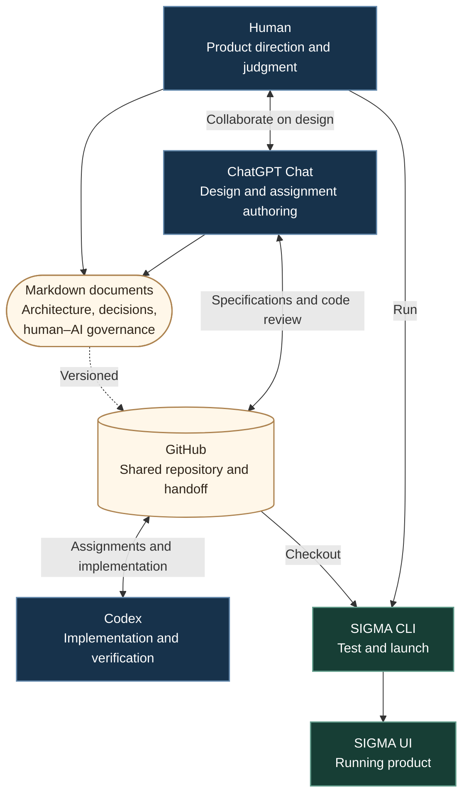

# SIGMA: Building with agents, then building for agents

SIGMA (Strategy Investigation, Generation, Measurement & Assessment) is a local-first application for organizing research into difficult problems. Its development uses a deliberately structured collaboration between a human, ChatGPT Chat, and Codex.

## 1. Development workflow

**Human:** Sets product direction, collaborates on design, evaluates decisions, and exercises the running system.

**ChatGPT Chat:** Works with the human on architecture and specifications, inspects the repository, writes detailed Codex assignments, and reviews implementation evidence.

**Codex:** Implements assigned changes, maintains the code and tests, verifies behavior, and commits results.

**GitHub:** Carries the durable handoff between Chat and Codex. The two agents do not share an ongoing conversation or internal state.

### Information flow

The process begins with an open-ended conversation between the human and Chat. We work through the intent, scope, tradeoffs, and acceptance criteria before producing a coding assignment. Chat commits the assignment to GitHub as Markdown. Codex reads it from the repository, implements the change, tests it, and commits the resulting code and verification record. Chat can then inspect the committed work. The human pulls the code and runs SIGMA through its CLI and UI, informing the next cycle of design.

The **shape of information changes across these boundaries**. Human–Chat exchanges can be broad, exploratory, and informal. Chat–Codex handoffs are precise, versioned instructions with explicit constraints and proof of completion. Codex returns executable software and test evidence rather than a conversational assurance that the work is done.

### Shared documents and governance

The human and Chat jointly maintain higher-level Markdown documents alongside coding assignments: architecture, product direction, technical decisions, and rules governing human–AI interaction itself. These are not ephemeral prompts. They become part of the repository's durable context for future assignments. [`docs/HUMAN-AI-INTERACTION.md`](docs/HUMAN-AI-INTERACTION.md) specifies responsibilities and authorization boundaries, how to respond to criticism, how to distinguish proposals from verified facts, and when prior design decisions remain binding.

### Co-maintaining CLI, UI, and tests

**Every assignment maintains the CLI, UI, and test suite together.** They are different interfaces to the same underlying behavior, not separately evolving products. Codex must account for command-line behavior, browser behavior, and the tests that exercise both. Implementation and verification travel together through the same GitHub handoff. Keeping these three surfaces synchronized makes the CLI useful for direct inspection, the UI consistent with the underlying system, and the test suite a durable statement of expected behavior.

### Engineering roles and boundaries

This is human-directed agent-assisted software development, rather than an autonomous swarm. The human remains engaged in design and judgment; Chat contributes independent engineering reasoning and explicit assignments; Codex supplies implementation and verifiable results. The division is deliberate: it allows fast iteration without treating generated code, agent confidence, or a successful demo as sufficient evidence of correctness.

The central challenge is **continuity across separate agents and repeated iterations**. Durable specifications, shared governance documents, source control, and co-maintained tests are the mechanisms that preserve that continuity.

## 2. Agents within SIGMA

The architecture and information flow of SIGMA's future multi-agent research engine remain to be determined. That is a separate design problem from the development workflow described above.

## 3. The five-worker software factory

By October 23, SIGMA's development process had converged on a small **software factory** with **five AI workers**: four separately operated Codex sessions, **Blue, Green, Red and Gray**, plus **ChatGPT** as an engineering contributor. Blue has implemented orchestration and model controls; Green has implemented the isolated Python executor and outcome measurements/provenance. Red is being oriented toward cloud work and Gray toward interface refinement. Assigned future work is not the same as completed code.

The human is the product owner, and has deliberately taken responsibility for **ideation, messaging between the disconnected workers, and manual review of the running UI**. ChatGPT handles architecture, ticket design, engineering coordination, repository inspection and edits, PR review, merge decisions and integration. The colored Codex workers handle bounded implementations and automated verification. It is a coordinated, human-operated process, not an invisible autonomous swarm: ChatGPT does not control or monitor the local Codex terminals.

### How work is created and distributed

The workflow starts with a discussion of intent, observed behavior, scope and tradeoffs. The human's feedback does not automatically become an unreviewed change. When the design is settled, ChatGPT writes a narrow **T-numbered ticket** in `tickets/`, with testable acceptance conditions, constraints, error behavior, and a frugal model/thinking recommendation. `TICKET_TRACKING.md` records ownership, status and links to reviewable work. GitHub supplies durable context across workers that cannot share continuous memory.

The ticket is passed to the appropriate color specialist. That worker develops in a separate checkout and branch, executes `./sigma setup` and `./sigma test` as appropriate, adds focused browser or integration checks, and submits a PR without self-merging. ChatGPT checks the implementation against its contract, reviews the actual diff and test evidence, and requests corrections where needed. The worker owns its fixes and integration with an updated `main`. ChatGPT sequences and merges reviewed PRs; combined-code verification and human UI evaluation remain separate checkpoints. The human carries messages between terminal sessions and exercises the application, supplying the observations that drive the next round.

### A real Day 3 integration

The sequence was exercised with [PR #11](https://github.com/bkramerext/sigma/pull/11) (migration from assignments to durable T-tickets), [PR #13](https://github.com/bkramerext/sigma/pull/13) (Green's metrics and provenance data), and [PR #12](https://github.com/bkramerext/sigma/pull/12) (Blue's model/thinking header controls). Review exposed concrete discrepancies. A report export was truncating unequal-length metric groups; a table had crept into T24 even though Gray's T25 owned Outcome presentation; Blue's original controls were in the wrong place and did not preserve the desired four-pill hierarchy. Both workers corrected their PRs. After #11 merged, their branches incorporated the new `main`, reported renewed test runs, and were merged in dependency order by ChatGPT.

That is a bona fide engineering loop: **specification, parallel implementation, independent review, revision, integration, and observable evidence**. It is not evidence that all integration risks or research-quality challenges are closed. In particular, a successful PR merge and deterministic tests do not replace a combined-runtime smoke test or a human judging whether the UI feels correct. A five-worker operation has created a new responsibility too: keeping handoffs and shared architecture aligned without overwhelming the human who carries the messages.
