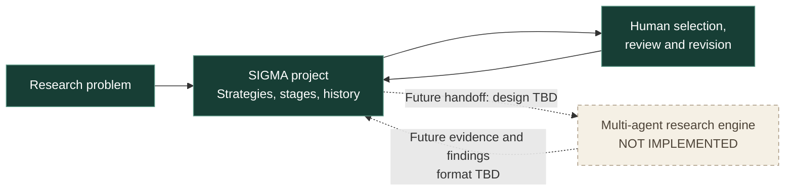

# SIGMA: Building with agents, then building for agents

*A working account of two related engineering efforts: how SIGMA is being built with AI agents, and how SIGMA may eventually coordinate research agents. The first is operational; the second remains to be designed and implemented.*

## 1. Building SIGMA with ChatGPT Chat and Codex

I'm building **SIGMA (Strategy Investigation, Generation, Measurement & Assessment)**, a local-first application for maintaining several approaches to a difficult research question without losing track of why an idea was pursued, what was tried, or what failed. It grew out of my experience doing mathematical investigations with ChatGPT, where conversational exploration was productive but hard to make cumulative.

I wanted not only to use coding agents to make the software, but to examine how we could organize that work without losing engineering coherence. Our practical arrangement has three participants with deliberately different responsibilities: **I direct and evaluate the work, ChatGPT Chat develops designs and writes engineering assignments, and Codex implements and tests the software.** GitHub is the durable intermediary between Chat and Codex.

This is a *human-directed agent-assisted engineering workflow*, not a claim that two agents are independently running an autonomous team. In fact, making the responsibility boundaries clear is part of the point.

### Development workflow and information flow

The diagram shows the main responsibilities and durable handoffs, not every individual exchange. Chat and I collaborate on design and governance; GitHub carries the shared documents, Codex assignments, implementation and evidence. I run the code through SIGMA's CLI and UI to see how the system actually behaves. Routine feedback, including test failures and usability corrections, feeds the next design iteration without needing an arrow for each kind of message.

**Markdown is not just an assignment format.** Chat and I also collaborate on the higher-level product description, architecture and rules governing our own interaction. Those documents include explicit guidance on agency, when Chat may commit changes, how to handle a serious mistake, how to report uncertainty, and how to preserve a design once approved. They are versioned alongside the source code rather than being left as fragile conversational agreements. For example, [`docs/HUMAN-AI-INTERACTION.md`](docs/HUMAN-AI-INTERACTION.md) makes our working relationship itself an object of design.

### What this looks like in practice

A feature usually starts with a product conversation, not a code request. I describe a capability, push back on awkward behavior, and try the design out with Chat. Chat explores the repository, produces a fairly exact Codex assignment, and commits it to GitHub. Codex then implements against that specification, runs automated and browser checks, and commits its changes and evidence. I pull and run SIGMA locally, and we iterate based on observed results.

The assignments are intentionally more explicit than the conversation that produced them: they specify contracts, corner cases, what must remain unchanged, and what evidence would count as completion. That has become important because the agents **do not share an internal memory or continuously negotiate with each other**. The repository provides a concrete, inspectable handoff.

**We co-maintain three interfaces on every assignment: the CLI, the UI, and the tests.** A feature is not finished when one screen works. We expect the command-line operations and browser workflows to reflect the same underlying behavior, and the automated tests to evolve with them. Codex is responsible for checking all three together, including regressions outside the feature's immediate UI. That discipline keeps the CLI useful as a direct way to exercise the system, the UI consistent with it, and the test suite an executable record of the intended behavior rather than a cleanup task at the end.

A useful example was the launcher. SIGMA initially made me manually load environment variables and stop an existing server before restarting. That may have been technically acceptable in isolation, but it was bad product behavior. The next assignment required `./sigma ui` to read its own local configuration and safely replace an earlier SIGMA instance without touching unrelated processes. The solution was driven by observing real friction, turning the complaint into testable behavior, and maintaining the original security constraints rather than making the user absorb the complexity.

Another example is how we preserve state and approved design. A change to a project is saved at the moment of the successful operation, not when a window closes. UI artwork that was explicitly approved is preserved instead of casually regenerated. When I ask for a correction, the handoff has to distinguish an actual fix from a broader redesign.

### What I've learned

My main lesson is that **agent speed is not the same as engineering throughput**. Without durable context, explicit scopes, and evaluation, agents can produce plenty of code while drifting from the product. Good orchestration means deciding which decisions belong to the human, which design work Chat should own, what Codex must verify, and how evidence comes back into the next iteration.

The human is not merely a person who approves pull requests. I contribute design, inspect behavior, question assumptions, and help create the governance rules themselves. Chat is not just a prompt generator: it makes independent engineering judgments, can inspect the source, and translates product intent into executable assignments. Codex is not treated as an infallible implementation service; its work has to be tested and observed.

**Outcome to date:** a running local application with persisted research projects, editable and ordered strategies, audit history, CLI/API/UI interfaces, and human-reviewed AI strategy proposals. Some additional work, including improved connection handling and recent projects, is still at the assignment stage. The development workflow itself is operational today.

## 2. The multi-agent research engine inside SIGMA

*Design to be developed. Do not describe this as implemented.*

The more ambitious side of SIGMA is to move from software *built using agents* to software *that coordinates agents*. The motivating research problem is that difficult questions admit competing lines of attack, sometimes with very different mathematical methods. A useful system must preserve distinct hypotheses and the evidence for or against each rather than flatten everything into one persuasive narrative.

Right now SIGMA provides a **human-operated research substrate**: projects, strategies, explicit human-set stages, history and a proposal workflow. It does **not** yet run autonomous investigators, assign parallel research tasks, arbitrate between agents, or independently verify mathematical claims.

### Current boundary and the unfinished design

We still need to determine **which agents exist, what they are allowed to do, how research is partitioned, how claims are evaluated, what constitutes evidence of progress, and who decides to stop or branch a strategy**. These are genuine design questions, not details to invent to fill in a diagram.

There is a useful connection between the two halves: our experience building SIGMA has already shown the value of persistent artifacts, bounded assignments, human judgment, feedback loops and honest verification. Those lessons may inform the research engine, but they are **not yet proof that the same structure is right for autonomous mathematical investigation**.

*Update this section with actual implementation, tests, failures and outcomes as the internal agent engine develops. Keep future intentions distinct from demonstrated work.*

