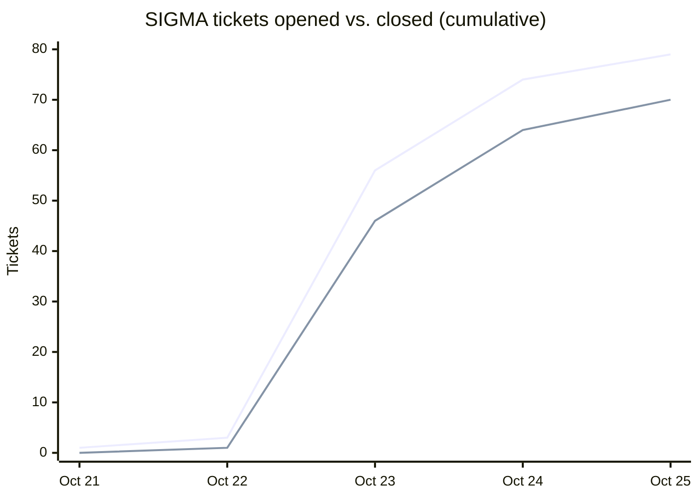
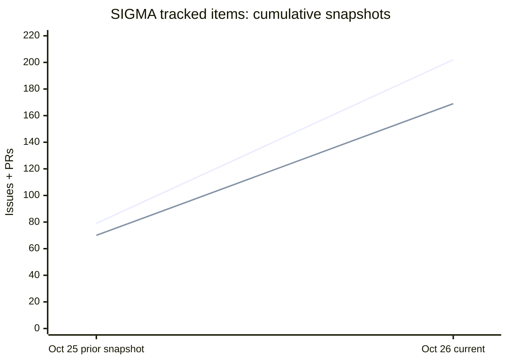

# SIGMA journal

High-level milestones, recorded by day.

## Day 0 — October 20, 2026

**Theme: establish the local research workspace and development workflow.**

- Initialized SIGMA's Python/FastAPI and React/TypeScript application, CLI, tests, and project conventions.
- Established local-first persisted investigations, editable project settings, strategy creation and history, sample mathematical investigations, and Recent Projects.
- Integrated ChatGPT authentication and the opt-in AI proposal path. AI-generated drafts require explicit user acceptance before being saved.
- Introduced versioned implementation assignments, shared service contracts, and accompanying automated checks for backend and browser behavior.

### Initial integration and verification

The first end-to-end launch exposed two artwork-integration defects: the expected runtime image was missing, and a substitute UI mockup was later loaded as the actual Home background. The correct source image was installed and verified in the running browser. Validation distinguished packaged assets, served output, and observed UI behavior.

SIGMA's initial persistence model supports project identity, reversible edits, event history, and test fixtures. It provides the basis for subsequent research provenance and reproducibility.

### Authentication and connection status

The ChatGPT connection flow was exercised successfully, including the first-connection welcome notification. Subsequent use revealed that the interface displayed an expired connection check after a 60-second cache period, even though account authorization itself had not necessarily expired. A follow-up assignment (`A8.2.1`) was created for quiet status refresh and accurate transient-error handling; it was not yet implemented at the time of this entry.

Independent model review and other autonomous research capabilities were identified as future work, distinct from the single-request proposal feature available at this stage.

## Day 1 — October 21, 2026

**Theme: research-workspace stabilization and preparation for autonomous investigations.**

Day 1 concentrated on core research-workspace interactions, implementation defects, and validation. Work included investigation creation, sample-project lifecycle, mathematical-text editing and conversion, AI strategy proposals, error handling, and development-server recovery. Multi-agent mathematical investigation remained the next major implementation milestone.

### A real workspace, not just a screen

- Consolidated the Home page into a compact **Projects** heading with **New** and **Open**, plus a Samples-first Samples/Recent catalog. Reworked the layout repeatedly across wide, laptop, and narrow viewports so the slogan, project list, and copper artwork no longer compete for space.
- Refined the approved copper beam and slogan placement. A subtle bug emerged when the background used `cover` scaling: a fixed overlay offset drifted away from the artwork as the viewport resized. The beam's dimensions and offset were tied to the same cover-scale factor. The approved underlying image was preserved.
- Unified the investigation header and controls, tightened spacing, removed redundant project labels and visual noise, and made title and description editing more direct. Strategy names became editable in place with explicit Save/Cancel, keyboard submission, Escape handling, and stable focus.
- Reworked strategy creation so **New** and **Generate** sit visibly with the Strategies heading. The generation composer moved inline and gained a truthful working/hourglass state rather than inactive-looking controls or an invented progress percentage.
- Simplified strategy commands, implemented a working **Fork** draft flow, and retained the ability to edit, remove, reorder, and review strategy history. The existing manual stage labels remain manual; `Exploring` does not imply an agent is running.
- Completed substantial groundwork for research text: durable Plain and Markdown representations, deterministic rendered Markdown/LaTeX, in-place edits, source authority and stale-cache behavior. These are presentation and authoring capabilities, **not mathematical verification**.

### Numerous bug fixes and regressions

Much of the day consisted of finding places where plausible behavior broke when used for real.

**Sample projects and naming.** The original sample-open workflow did not match the desired working-copy semantics. Opening a sample template now creates an independent managed copy, retaining the checked-in example unchanged, and records the copy in Recent Projects. We added tests for independent identity, exact fixture preservation, and reopen behavior. We fixed naming collisions across sample, recent, and saved investigations, gave repeated sample copies deterministic display suffixes (`(copy)`, `(copy 1)`, etc.), improved the duplicate-title explanation, and tightened private permissions on the naming lock. An earlier Day 1 note saying that sample opens themselves remained outside Recents is superseded by this final behavior.

**Home and keyboard behavior.** Iterative fixes addressed the overlap between the copper artwork, project controls, and recent list; position and scaling drift after resize; inconsistent Remove-link placement; the order of New/Open actions; and unwanted focus styling on the Projects heading. Strategy inline renaming initially interfered with disclosure-click behavior and keyboard focus; follow-up fixes preserved input focus, enabled Enter to submit, and avoided toggling the strategy row while editing.

**Terminology and compatibility.** The shift toward **Investigation** required more than replacing labels. An initial broad rename was reverted, and the surviving changes were made selectively, including the `investigation_type` model/API field with compatibility for legacy `research_mode` input. Pre-v4 serialization, catalog/recent models, and tests were corrected. Existing project files were not casually rewritten on read.

**Markdown conversion failures.** The reported conversion error was especially instructive: SIGMA surfaced a local HTTP 400 while the ChatGPT-plan provider had actually returned HTTP 200 with an untyped streamed response. The previous adapter attempted JSON parsing, lost the real payload shape, and characterized the placeholder as a provider rejection. The A14.2 repair recognized valid untyped SSE through the strict stream validator, distinguished malformed output from genuine provider rejection, and preserved the original text on failure. A subsequent fix accepted the relevant JSON and SSE response forms and retained actionable sanitized diagnostics. No hidden API-key fallback or billing-mode switch was introduced.

A second conversion defect came from reusing **Generate Strategy's 128 KB response-envelope limit** for potentially larger Markdown conversions. Valid conversion responses could exceed that limit even when the actual converted text was bounded. Text conversion received its own explicit **1 MB envelope cap**, with tests for both large valid responses and oversized rejection without data loss. We also fixed the Σ conversion control's tooltip and working-state feedback: **Convert to markdown**, **Converting to markdown**, then **Show plain text**.

**Request failure behavior.** Network-bound errors needed a single dismissible **Request Failed** toast, followed by a correct feature-specific state. A conversion failure must leave the readable source intact; a generation failure must retain the draft/starting point and permit explicit retry. An HTTP error must never masquerade as a successful conversion or silently navigate to an empty rendered view.

**Development launcher recovery.** Restarting SIGMA exposed a harder operational problem: suspended launcher processes and orphaned FastAPI/Vite servers could retain locks or ports. The launcher gained ownership records and a matching-checkout shutdown path. Further fixes addressed legacy suspended processes without ownership files, multiple verified lock holders, and separately verified orphan listeners. Recovery checks process identity, user, executable/checkout, and server identity before signalling anything; unrelated listeners are intentionally left alone. These fixes were committed with offline tests, **but full macOS restart/suspension verification remained pending**. They should not be described as field-proven yet.

**Test and build stabilization.** The source-controlled scenario suite was renamed to `tests/`, and its launcher/import/test scopes were updated. Several tests had stale expectations for the current investigation schema, Recents semantics, or sample-copy lifecycle; these were corrected rather than changing valid runtime behavior to satisfy obsolete tests. Formatting and type-check regressions found by the full suite were repaired.

### AI strategy generation: a reliable baseline

The strategy-generation work is separated into these implementation milestones:

- **A15:** Make the ordinary, **single-LLM-request** Generate Strategy path function end to end.
- **A16:** Extend that baseline with real independent Explorer/Critic invocations, critique-driven coordination, revision and bounded retries.
- **A17–A21:** Build the larger research engine around persistent artifacts, proof obligations and discriminating tests, strategy-wide orchestration, user control, and auditability.

The A15 investigation found that the UI was calling the streamed A14 agentic endpoint despite an already-existing bounded single-proposal backend. The visible flow was moved to that backend. It now returns an **editable, unsaved draft**; only explicit Save writes a strategy. It retains model, thinking, account and billing identity safeguards, refuses stale results when the investigation changes during inference, and recovers safely from cancellation or provider errors. The underlying A14 agentic code remains available for A16 rather than being discarded.

A15 passed documented mocked-provider/API tests and a real-Chrome UI scenario: the zero-strategy counting example, empty starting point, one request, unsaved result, cancellation without mutation, failure toast, explicit edited Save, reopen, and a further proposal with prior-strategy context. **This was not a live proof-finding run**, and the heavy agentic workflow was not yet certified as the user-facing research engine.

### What we actually verified

The repository's `docs/STATUS.md` contains detailed command-level reports. Across the reported changes, `./sigma test`, Ruff, Pyright, frontend typecheck/Vite build, and several real-Chrome browser checks were run successfully. The text-conversion regression also records a **real connected ChatGPT-plan smoke test** after its fix: the provider returned HTTP 200, the local API returned HTTP 200, a nonempty Markdown representation was persisted, and the original project JSON remained byte-for-byte unchanged. Two earlier diagnostic requests had reproduced the failure and may have consumed plan usage.

The A15 generation checks used deterministic mocks, **not a paid live-model acceptance test**. The launcher recovery patches still need the noted macOS verification. These distinctions matter: committed code, green mocked tests, real-browser validation, successful live provider calls, and proven mathematical results are different kinds of evidence.

### Next: multi-agent mathematical investigation

The next research-engine requirements draw on earlier Riemann Hypothesis investigations: speculative mathematical approaches should identify their mechanisms, proof obligations, boundary conditions, negative controls, and explicit failure criteria.

That leads to several nonnegotiable requirements for the next implementation:

1. **Strategies carry active proof obligations and falsification tests.** A proposed rubric is not a generic confidence score. It specifies conditions, discriminating checks, failure criteria, evidence quality, and reasons to continue, revise, pivot, or stop. A decisive counterexample outranks an attractive numeric rating.
2. **Agents perform recorded work.** Generators, critics, test executors, and coordinators must leave behind typed, durable public artifacts and results. No fictitious progress, fabricated tool execution, or retroactive invention of evidence.
3. **Research spans multiple strategies and iterations.** Each attempt has a bounded budget and explicit states such as investigating, blocked, failed, or awaiting human review. One strategy can contribute a lemma or constraint to another without erasing either one's history.
4. **Lineage is first-class.** A result must be traceable backward through the **actual recorded dependencies** among claims, tests, agents, strategies, and human decisions. A plausible-sounding LLM narrative written afterward is not provenance.
5. **Success claims are gated.** A model can propose a candidate solution and independent agents can critique it. Neither a high rubric score nor agent agreement proves a mathematical theorem. Verified results require evidence commensurate with the claim.
6. **Human control remains explicit.** The user can inspect, prioritize, intervene, pause, override, and resume. Such changes must themselves be recorded with attribution rather than silently altering research history.

The planned implementation sequence is **A16 → A17 → A18 → A19 → A20 → A21**, followed by hosting, sample-investigation content, documentation, and end-to-end verification. Agentic investigations, cross-strategy research, and lineage tracing remain requirements in progress.

### Day 1 retrospective

The day's fixes strengthened capabilities needed by the research engine: stable identity, model/account binding, atomic persistence, reversible user actions, guarded concurrency, truthful error reporting, compatibility across versions, and tested failure paths.

**Auditability begins in the supporting services.** Accurate response parsing, safe process ownership, immutable source data, persistent provenance, and reproducible tests are prerequisites for attributing future mathematical claims to actual evidence.

The next implementation step is a constrained research loop with checkable actions, critic-reviewed claims, durable state changes, and traceable paths from findings to their supporting evidence.

## Day 2 — October 22, 2026

**Theme: make SIGMA a coherent research workspace and establish the standards for autonomous, evidence-based investigation.**

- Completed the A17 research workspace through successive rounds of **UI cleanup and standardization**, including a dedicated Research Sessions pane, consistent controls, clearer strategy management, and live research supervision.
- Added research outcome and strategy assessments, durable research artifacts, and project-level **Report Artifact** exports. Refined document presentation and PDF/HTML/LaTeX-oriented output.
- Completed A17.8's review of agent coordination and research trustworthiness, strengthening the distinction between an interesting result and a supported finding.
- Implemented and merged **A20: AI-authored research papers**, grounded in recorded research and explicit verification status.
- Added **A23 project difficulty** and three broader investigation samples spanning algorithms, experimental science, and physics.
- Defined the next substantial research milestone, **A18**, and prepared **A19**'s isolated Python execution capability. Finished the day with two independent Codex sessions assigned overnight development.

### A unified research workspace

Most of the day's visible progress came from treating SIGMA as an application people must actually use, not a set of individual features. Across A17.1–A17.7, we standardized titles, section headings, inline editing, disclosure patterns, action placement, hover/focus behavior, and the visual treatment of enabled, disabled, and destructive operations. Home, Settings, the project header, strategy rows, session details, and narrow-screen layouts received coordinated attention. These changes reduced the need for users to rediscover how each part of the interface works.

The investigation view settled into a clearer hierarchy: **Projects**, **Research Sessions**, and **Strategies**, with collapsible sections where appropriate. The new Research Session pane sits between the project and its strategies, providing the place to start, resume, supervise, and inspect actual research activity. We chose not to add previous/next session arrows without a demonstrated need. The goal for the first pass was a productive control surface, not a comprehensive navigation system.

Strategy management also became more direct. We removed the misleading stage column while preserving historical data, clarified disable/enable behavior, made Fork and Remove accessible in the title row, and kept strategy names and ordering unambiguous. Research status belongs primarily to the running session, not to a manually assigned strategy label.

**What we learned:** coherent interaction patterns are functional infrastructure for a complex product. More controls do not necessarily mean more control. The interface should make the current state and next meaningful action obvious.

### From activity to inspectable research

A17 evolved beyond showing that agents were busy. Research sessions gained clearer progress and outcome displays; strategy assessments and attribution; and inspectable artifacts that can be read as source text or rendered Markdown. We refined the distinction between starting fresh work and resuming a previous session, and between a running investigation, a recorded outcome, and a claim about the quality of that outcome.

The **Report Artifact** workflow made research export part of the product rather than an afterthought. It combines selected research material into a document with deliberate layout, format, filename, and presentation choices. We improved typeset mathematical output, browser preview, and the consistency of report/export controls. The point is to produce something another person can inspect and use, not simply download a transcript of agent messages.

A17.8 then challenged the quality of the research process itself. Agent critique and coordination were strengthened around objectives, evidence, limitations, and explicit trustworthiness criteria. Its improvements were merged through PR #4.

**What we learned:** agent activity is not evidence of progress. A useful research system must distinguish hypotheses, tests, counterexamples, assessments, and results, and make it possible to trace important conclusions back to the work that supports them.

### Turning research into publications, without overstating certainty

A20 added an AI-authored research-paper workflow and was merged through PR #5. Papers can assemble and explain recorded research in a more formal structure while using the established export capabilities. We iterated on mathematical exposition, the amount of evidence included, and practical generation limits.

The important design boundary is that **a well-written paper is not a verified proof**. Claims should retain their actual evidentiary status; older records lacking an explicit verification result remain **unknown** rather than being treated as confirmed. We also documented a future path to Lean-based formal verification, while keeping that capability clearly separate from current LLM review and mathematical presentation.

This gave SIGMA two complementary outputs: **research artifacts** that record the investigation and **papers/reports** that communicate it. The latter must remain faithful to the former.

### Broader investigations and deployment direction

The day's work also widened SIGMA's applicability beyond its Riemann Hypothesis showcase. We added sample investigations in **incremental dependency scheduling**, **unexpected experimental oscillation**, and **warp-drive physics**. They provide different kinds of questions against which to evaluate strategy generation, research controls, and the quality of evidence. The new samples were merged through PR #7.

A23 introduced a descriptive **difficulty setting**, merged through PR #6. Difficulty is useful context for evaluation and presentation, not a substitute for measuring research success. Older projects can retain an unknown value without inventing certainty.

We also defined **A22 cloud deployment** requirements, including identity, private workspaces, and secure execution boundaries. Hosting SIGMA will require more than moving the existing UI to a server: research workloads and their artifacts need an isolation and persistence model suitable for remote operation.

### Research autonomy and the overnight handoff

The next major engineering step is **A18**, assigned to **Blue**. Its scope was sharpened throughout the day: multiple agents and strategies should conduct sustained investigations, coordinate findings, challenge each other's reasoning, record dependencies and failures, and expose genuine live status to the user. We added concrete Easy and Medium evaluation targets, stress-testing expectations, and honest reporting of complete, partial, blocked, and failed outcomes. A18 remains underway, not a demonstrated solution to hard mathematical problems.

In parallel, **Green** was assigned **A19**, beginning with a standalone sandbox for agent-generated Python. Research agents need a way to perform computations and experiments with scientific libraries while containing execution through resource limits and disabled network access. This executor will ultimately be callable by the A18 orchestration and may also support A22's cloud architecture. A18 is an integration dependency, but it need not prevent independent A19 implementation and testing.

We finished Day 2 with **two autonomous Codex development sessions running in separate checkouts**: Blue developing A18's research engine and Green developing A19's Python executor. Their work will be reviewed against actual behavior, tests, and recorded artifacts rather than assumed complete because agents were left running overnight.

### Day 2 retrospective

The most significant change was conceptual as well as technical: SIGMA now has a more coherent way to **control research, preserve its work, assess its quality, and communicate its results**. The remaining challenge is to make the research itself genuinely productive.

The day reinforced three standards for that next step: **simplify the user's control surface; make every consequential research claim traceable to evidence; and evaluate agents by reproducible outcomes rather than convincing narratives**. Those standards define the overnight work and the next round of integration.

## Day 3 — October 23, 2026

**Theme: turn the research prototype into an integrated, testable alpha while preparing a controlled cloud launch.**

- Integrated the overnight **A18 multi-strategy research engine** and **A19 isolated Python execution**, then added agent-aware **SageMath** support. Research can now coordinate bounded concurrent investigations and use computational tools while retaining session history and evidence.
- Improved the quality and inspectability of research: richer **Outcome** views, evidence handoffs and citations, research memory, human intervention during active sessions, and adversarial evaluation cases. A bounded **live answer-free trial** produced a mathematically sound candidate with substantive Skeptic criticism, but exposed audit limitations that were corrected in code.
- Completed a broad **local alpha acceptance pass**, including real-browser checks of session controls, settings, samples, exports, and responsive UI. Continued polishing the project header, session controls, and Outcome presentation rather than treating UI quality as a final cosmetic pass.
- Established a **five-worker software factory** with scoped T-numbered tickets, tracked ownership, separate branches, independent reviews, and coordinator-managed merges. Added CI checks to make integration more repeatable.
- Advanced cloud readiness through **Google authentication, private workspaces, durable bounded research execution, public read-only Demo, account administration, and per-user spending limits**. After evaluating Cloudflare and Google Cloud, prepared a Google Compute Engine deployment package and provisioning runbook. Selected `sigma-research.duckdns.org` as the public hostname. **No cloud resources were provisioned today.**

### Research engine and computational evidence

The overnight work moved SIGMA beyond isolated agent responses. **A18** introduced bounded concurrent research across strategies, with explicit coordination and recorded outcomes. **A19** supplied a sandboxed Python execution path for experiments, and **T26** extended computational work to SageMath. These tools support research, but their existence is not evidence that a mathematical claim has been proved.

Subsequent work strengthened the connection between an agent's conclusion and its basis. **T27** improved handoffs and research history; **T28** made computational evidence inspectable and citable; **T29** enabled human intervention during active research; and **T37** addressed selection and reuse of trustworthy research memory. The Outcome UI was reorganized to make results, limitations, and provenance easier to inspect. Together, these changes moved the product toward an evidence-bearing research process rather than a persuasive conversation transcript.

We also expanded the sample catalog beyond mathematics, including biology, chemistry, and a creative-research investigation, and added workflows for turning exported projects into reusable samples. An exact Riemann Hypothesis adversarial oracle and other evaluation cases provide ways to challenge agent behavior without assuming that an attractive response is a correct discovery.

### Live research trial and the limits of acceptance

A key test was the **answer-free “Maximum Regions Formed by Lines” investigation**, run through the connected ChatGPT provider within an explicitly bounded budget. The Investigator first established an upper bound but had not justified attainability. The Skeptic identified that gap, and a later cycle supplied a line construction with distinct pairwise intersections, supporting the result `1 + n(n + 1)/2`. The session correctly labeled its outcome a **solution candidate (unverified)**, not a formally verified theorem.

The trial demonstrated meaningful mathematical criticism and revision. It also exposed important audit weaknesses: exact role inputs had not been preserved, long outputs were truncated without clear signaling, aggregate token usage was inconsistent, and some obligation and portfolio labels disagreed. The original run's answer independence therefore **cannot be established retrospectively**. Green's independent assessment documented those limits; Blue implemented request-input auditing, usage and outcome corrections, saved-session browser checks, and a final concurrency fix binding each audit to its exact call step. The corrected implementation passed the full suite and was merged through **PR #53**. No second live trial was run, and the original trial is not retroactively certified by the repair.

**What we learned:** a good answer and a good critique are necessary but insufficient. Trustworthy autonomous research also requires faithful request records, consistent accounting, reproducible evidence, and a clear distinction between a candidate result and verification.

### Local alpha quality and the software factory

The day's acceptance work exercised SIGMA as a product: project and strategy workflows, session supervision, settings, generated reports and audit exports, saved-session inspection, and desktop/mobile browser behavior. **T21** recorded a full local acceptance pass, with targeted corrections to session and header behavior. Further improvements to the Outcome hierarchy, model/thinking controls, keyboard and control placement, and launcher reliability helped bring previously separate features into a coherent interface. A green local suite and successful browser checks establish a stronger alpha baseline, not universal reliability.

The development process matured alongside the product. **Blue, Green, Red, and Gray** worked in separate Codex checkouts, with **ChatGPT** coordinating architecture, tickets, review, integration, and merges. The human remained responsible for product direction, manual visual judgment, and relaying messages among isolated workers. We replaced informal handoffs with **T-numbered tickets**, a tracking ledger, branch/PR ownership, documented acceptance conditions, and CI coverage for tests, lint, types, and frontend build.

This organization made substantial parallel progress possible, but the final T17.8 review also revealed the cost of excessive handoffs. The useful discipline is to **converge on a bounded correction and merge decision**, not to create repeated review loops after the material issues have been identified.

### Cloud architecture and launch preparation

Cloud work progressed from feasibility to a concrete deployment plan. The team evaluated Cloudflare's constraints, then pursued a **Google Cloud trial-based alpha** with Google sign-in, invited access, per-user private workspaces, durable bounded jobs, and a curated public Demo. Local account-management UI and per-user spending controls were added to support an operator-controlled launch. The cloud deployment package, authentication fixes, and provisioning documentation were integrated; local Compose and test validation were reported passing.

The chosen hostname is **`sigma-research.duckdns.org`**, with DuckDNS intended to point to a static cloud IP. The runbook separates pre-launch preparation from actions that create billable resources and documents staged checks for authentication, persistence, access isolation, and cost. **Actual Google Cloud provisioning and public launch were deferred to Day 4.** Passing local cloud-mode tests is not the same as validating a running public service.

### Day 3 retrospective

SIGMA finished the day with a materially stronger **research engine, computational tooling, evidence model, operator interface, and deployment foundation**. The team integrated a large amount of parallel work and completed local acceptance without claiming that the live trial proved general mathematical reliability or that the cloud service was already online.

Three lessons stand out: **research progress must be backed by inspectable evidence; a polished control surface is part of operational correctness; and parallel AI development succeeds only when review and integration converge.** Day 4's priority is provisioning and validating the hosted alpha, with real access, isolation, persistence, and spending behavior checked against the prepared launch gates.

## Day 4 — October 24, 2026

**Theme: improve the substance and continuity of research, simplify the product's explanations, and confront the limits of autonomous development coordination.**

- Integrated **T70 substantive research outcomes**, **T45 resumable long-form papers**, **T47 persisted Outcome conclusions**, and **T46 About SIGMA**, with corresponding browser and regression work. Strengthened reasoning preservation, report fidelity, and the separation of qualified findings from proof.
- Reworked strategy generation toward **bounded research directions**, not solution-sized plans. Continued consolidating the documentation and backlog, while preserving the distinction between durable strategies and individual session outcomes.
- Launched a new Blue research-quality initiative in short increments: conservative verification labels, a current-research-state view, explicit evidence continuations, and real Python/SageMath execution feedback. **Blue Increment 5** reconciled these capabilities with Green's Simple/Advanced Outcome modes and was merged through **PR #77**.
- Refined Home presentation, account/status pills, copper background artwork, and the About diagram. Discovered that Red's supposedly authoritative About branch had diverged from the branch containing its latest implementation; began a clean selective integration on current `main` through **PR #78**.
- Reworked the Blue/coordinator mailbox protocol to support repeated 30-second polling after each completed increment. Established that the coordinator's hourly automation does **not** provide an equivalent low-latency handoff, and did not claim that an indefinitely sleeping assistant could solve that limitation.

### Research conclusions, papers, and bounded strategies

The first half of Day 4 continued the prior day's push to make outcomes intellectually useful rather than merely polished. **T70** preserved structured Investigator arguments and step-level Skeptic review in outcomes, sessions, reports, and paper evidence. Assumptions remain explicit premises, conditional conclusions retain their scope, and failed strategies retain attribution and reasons rather than acquiring invented supporting artifacts. A failed branch need not fail a mixed portfolio when a sibling completes. Limits on step count or length should produce a named gap or partial result, not silently discard reasoning. T70 was integrated through **PR #70**.

**T47** added a persisted session-level Outcome conclusion with explicit qualifications and verification warnings, integrated through **PR #72**. **T45** addressed the practical limits of generating a long LaTeX paper in one model response: resumable stages preserve research evidence and continuity instead of forcing a deceptively compressed argument. It was integrated through **PR #68**. These changes improve the fidelity of presentation and export; they do not certify the mathematical validity of generated proofs.

Strategy generation was corrected to emphasize **narrow, testable directions** within a project's overarching problem. The project's question, a durable strategy, and a particular session attempt remain distinct. A strategy may fail locally, be revised and rerun, or lead to a child strategy without erasing the evidence of previous attempts. We also refined Getting Started and the backlog, consolidated overlapping cloud and collaboration documentation, and pruned superseded material. Documentation cleanup is useful only when it retains consequential design rationale and recoverable history.

### Blue's research-quality increments

Blue's new initiative deliberately separated an operational research loop from claims of autonomous mathematical discovery. **Increment 1** unified conservative verification labels and surfaced saved argument narratives. It avoided presenting agent confidence, numerical checks, or a candidate conclusion as an independently verified proof. **Increment 2** projected a compact **Current Research State** from explicitly saved evidence, including unresolved source references and recorded resolutions, without rewriting prior sessions or turning the summary into a new source of truth. Actual project exports and browser acceptance evidence were requested for review rather than relying solely on an agent's account of its work.

**Increment 3** exercised cross-strategy continuation: researcher-approved evidence could be selected for a later role dispatch, and the work retained the source's identity and limits. The evaluation distinguished real causal use of an earlier artifact from simply mentioning it in a generated narrative. **Increment 4** connected observed sandboxed Python/SageMath results to subsequent Investigator and Skeptic work and reduced repeated context without discarding information. The recorded offline exercises involved **scripted model responses**, not an autonomous live-model discovery. Finite computational tests remain evidence about the cases executed, not proofs of general claims.

**Increment 5** was the integration and provenance pass. It reconciled Blue's research changes with Green's current UI, retained explicit computational attribution, kept experimental context pooling opt-in, strengthened audit/export checks, and prepared a **blind research-quality gate** for eventual comparison against a simpler single-role baseline. **PR #77** merged into `main` at `4e25bd3`, with the reported post-merge verification green. The resulting machine can preserve and feed back evidence; whether the coordinated agents produce better research than a matched-budget baseline remains an open empirical question. Blue's next increment was assigned release verification and evaluation preparation, not a declaration of research success.

### Outcome and About: clearer explanations without overstating capability

**Green's Outcome hierarchy**, merged through **PR #76**, added project-level **Simple/Advanced** presentation choices and tightened concise conclusions and qualifications. The distinction is presentational: Simple should be readable without hiding uncertainty; Advanced should retain evidence and provenance. Preferences and research settings were preserved across the Blue integration. The Markdown icon visibility issue was also corrected.

**T46**, merged through **PR #73**, introduced an About SIGMA entry point and an accessible product explanation. Red subsequently developed a richer, interactive diagram depicting multiple strategy directions and the Investigator → Skeptic → Investigator critique loop, with expandable detail, tooltips, and a build identifier. This illustrates the intended research workflow without inventing a third AI 'coordinator' agent or suggesting that agent agreement constitutes proof. The visual work also included stacked account and administration pills and a revised copper Home background. The image was maintained in both `assets/` and `frontend/public/`.

The Home artwork received detailed manual review: the zeta summation was moved downward, the critical-line depiction was made dotted, the spurious glowing point at the origin was removed, and the intended symmetric first-zero markers were refined without numerical labels. These visual changes were directed at the **source asset**, not at a screenshot of the UI. The final source image was later found on Red's substantive branch rather than the branch Red had designated authoritative.

### Branch recovery and integration discipline

By evening, both Red and Blue worker sessions had stopped. Red had repeatedly checked out **`red/substantive-research-outcomes`** despite identifying **`red/about-green-integration`** as authoritative. The branches diverged: the latter retained the detailed About design specification, while the former held the newer About interactions, Home controls, and image assets. The substantive branch was also based on much older mainline history. Neither was safe to merge wholesale without risking more recent Blue and Green work.

The coordinator therefore created **`integration/red-home-about-20261024`** from current `main`, selectively transplanted the About/Home source and CSS, restored both matching copper image assets, added About browser acceptance checks, and preserved `docs/ABOUT_AGENT_COORDINATION_DIAGRAM.md` from the other Red branch. **PR #78** was opened against `main` with both original Red branches untouched as recovery points. GitHub reported it mergeable, but its initial **`verify` check failed**. The integration is therefore **not yet accepted or merged**; the CI failure and real-Chrome Home/About/auth/Outcome regressions require follow-up. Git mergeability is not a substitute for validation.

### Autonomous coordination and its limits

The Blue mailbox uses committed `messages/blue_in_N.md` and `messages/blue_out_M.md` on `blue_session`. After finishing an increment, Blue repeatedly fetches and polls approximately every 30 seconds until the next coordinator instruction appears, then repeats the process after the following increment. Inbound and outbound numbers are independent; treating them as matching caused avoidable confusion. The coordinator was required to inspect real diffs, tests, project exports, and evidence before accepting an increment or assigning another.

The remaining limitation is asymmetric: **Blue can poll every 30 seconds, but the standard coordinator automation wakes at most hourly**. The user rightly challenged the possibility of an overnight handoff waiting nearly an hour. A blocking `sleep` inside an active tool execution cannot guarantee an indefinitely self-running assistant after the conversation ends. Event-driven external orchestration was discussed as a possible remedy, but **was not installed or authorized**, and no continuous sub-hourly coordinator was claimed to exist. Short-lived branches, frequent integration, and truthful handoffs remain essential even with more automation.

### Day 4 retrospective

Day 4 advanced SIGMA from a functioning multi-agent workflow toward a more **evidence-preserving, cumulatively useful research machine**. It improved the fidelity of outcomes and papers, made the current research state inspectable, and connected actual computation to later research steps. The next scientific test is whether these mechanisms improve unscripted research quality against a simpler matched-budget baseline. The day's branch recovery also exposed a different reliability requirement: multiple coding agents need one unambiguous source of truth, not just successful local tests and confident handoff messages.

The day ended with **Blue Increment 5 integrated in `main`**, a further release-quality increment assigned, and **Red's newer Home/About work preserved in PR #78 but blocked on failed CI and browser acceptance**. No claim of autonomous discovery, formal proof, continuously active overnight coordination, or completed public cloud launch is warranted.

### Ticket throughput (snapshot: October 25, 2026 UTC)

The following cumulative counts include **GitHub issues and pull requests**. They are grouped by UTC date, so the final point includes activity after the Day 4 calendar boundary.

| UTC date | Opened (cumulative) | Closed (cumulative) | Open backlog |
| --- | ---: | ---: | ---: |
| Oct 21 | 1 | 0 | 1 |
| Oct 22 | 3 | 1 | 2 |
| Oct 23 | 56 | 46 | 10 |
| Oct 24 | 74 | 64 | 10 |
| Oct 25 | 79 | 70 | 9 |

**Interpretation:** 70 of 79 tracked items were closed (**89%**), with nine remaining open. The backlog stayed near ten despite a sharp increase in ticket creation, indicating strong completion throughput relative to intake. This is encouraging delivery momentum, not by itself evidence of software quality or research validity. In the chart, the first line represents **opened** and the second **closed**.

## Day 5 — October 25, 2026 (deployment continued into October 26 UTC)

**Theme: converge the parallel development branches, complete real host readiness, and bring SIGMA onto the public internet.**

Day 5 crossed the boundary from an extensively tested local research application to a running GCE-hosted preview. The critical progress was not a new feature: it was closing integration work, proving the isolation and deployment gates on the actual VM, recovering from a few misleading checks, and routing real HTTPS traffic to the application. The evening ended with the owner successfully opening the live site. Formal hosted acceptance, particularly research execution and sponsored inference, remained for the next day.

### Integration and release discipline

- Consolidated the remaining worker contributions and merged reviewed work promptly rather than leaving ready PRs in limbo. **PR #195** corrected inherited Docker environment handling in preflight. **Gray's PR #196** recorded release-integrity review and deterministic backup/rollback test evidence; it was documentation-only and merged. **Green's PR #197** recorded real-Chrome acceptance of paused sessions, saved-paper text/TeX/PDF downloads, inline PDF, Recent Projects polling, and a five-Outcome report export. It also fixed a saved-paper disclosure button's dynamic accessible name. Green's full local test/build suite passed.
- The proposed shared Codex launcher **PR #198** was closed without merge. It was coordination tooling, not a requirement for the preview. The owner explicitly chose to stop designing coordination infrastructure and concentrate on deployment. Workers continued through ordinary reports and targeted assignments.
- **Red's PR #199** corrected a second, distinct rootless Docker preflight defect: the checker invoked Docker as root with a bare socket path. It now runs the read-only Docker checks as `sigma-sandbox` and passes an explicit `unix:///run/user/1001/docker.sock` endpoint with inherited contexts cleared. The regression tests and full local suite passed. PR #199 was reviewed and merged at **`e1ef8db8ea6c15bcb79ad9c8d06e8e5f6f4527f3`**, the release SHA selected for deployment.
- A separate PR search found #198 and #199 still open after the earlier integration sweep. #198 was explicitly closed and #199 integrated. The lesson is to check PR collections directly rather than mistake an issue-only search for proof of a clean PR queue.

### Live GCE preflight and access

Red authenticated to the actual `sigma-gce-01` VM using the available Google Cloud operator context and IAP SSH. This established that live host checks were possible, though it did **not** prove that every separate Codex worker inherited the same credentials. The active identity had broad project Owner and OS Admin Login permissions; least-privilege worker identity remains future hardening work.

The installed checker initially failed rootless daemon and image inspection even though direct inspection as the sandbox user worked. Red ran the corrected preflight temporarily and read-only on the VM, obtaining **all PASS** host-readiness results. Evidence included rootless Docker and Python/Sage images, active Docker/sandbox units, sandbox denial of access to `/srv/sigma-state`, mount protections, firewall exposure limited to public 80/443 and IAP SSH, valid DNS/TLS, and a Caddy readiness page. At that stage the application itself was still stopped. The production gate also identified the retired `SIGMA_CLOUD_BOOTSTRAP_ADMIN_EMAIL` key in protected `/etc/sigma/deploy.env`. Red deliberately left both the installed checker and protected environment unchanged for the deployer.

The actual state disk was 30 GiB and the VM was `e2-standard-2`, smaller than an earlier 200 GiB/`e2-standard-4` planning estimate. This discrepancy needs reconciliation before sustained hosted research; it did not itself establish a failure of the preview.

### First production deployment

Gray took the deployment assignment, authenticated successfully, and inspected the installed VM release. Before changes, Gray found no existing recovery snapshot, so checked disk identity using the authenticated operator's GCE permissions and prepared a non-destructive recovery point. The VM runtime service account lacked disk-metadata read permissions; that fact did not prevent the operator from validating the attached disk. Gray installed the corrected preflight and pinned application checkout and addressed the retired environment setting under the deployment runbook.

An older release pin, **`e91a3bc5`**, was present in the remote environment. The owner challenged it. Gray clarified that the deployment helper was selecting the explicitly requested **`e1ef8db8`** commit, not the stale prior pin. The release helper subsequently reported that exact SHA started with healthy containers and verified state mount.

A manual post-start preflight appeared to fail Compose validation, prompting Gray to stop `sigma.service` rather than ignore a production gate. Investigation found the manual invocation had omitted **`--repository /opt/sigma/current`**; the systemd unit already passed this argument correctly. The direct Compose contract passed, and the corrected production preflight passed **all 23 rows**. All three application containers were healthy.

The public endpoint probe then exposed a genuine routing gap. Caddy still served the temporary 25-byte readiness page instead of forwarding to the healthy loopback application edge. Gray backed up the Caddyfile, replaced only SIGMA's hostname block with the documented **`reverse_proxy 127.0.0.1:18080`**, validated the configuration, and reloaded Caddy. The subsequent public probe passed DNS, private-port closure, HTTP-to-HTTPS redirect, trusted TLS, SPA deep-link routing, and hosted API readiness. Gray reported that a local Chrome smoke check remained constrained by missing browser tooling; the owner independently opened the public site and confirmed it worked.

**Public preview URL:** `https://sigma-research.duckdns.org/`. This was the first verified owner-visible hosted SIGMA interface. It is a deployment milestone, **not** certification that live research, OAuth edge cases, multi-account isolation, paid inference, recovery rehearsal, or every browser path passed production acceptance.

### First hosted exploration: defects found immediately

The first real browsing session produced actionable findings rather than a declaration of completion.

- **Issue #200: model-availability and pill-state confusion.** The page showed Google account connected, ChatGPT/SIGMA service with an amber indicator, dimmed model/thinking pills, and `Model availability could not be verified. Saved settings are unchanged.` The underlying availability request and actual inference status remain to be investigated; a warning is not proof that model execution is impossible.
- **Issue #201: Nonconsecutive Subset Summaries research stops immediately.** Pressing Play yielded a paused session with `Prior-session unresolved obligations exceeded the frozen context bound`, explicitly **no provider call**, and no saved result or Python/Sage computation. Two other strategies showed conservative cost-reserve stops. The displayed conclusion correctly identified an unresolved investigation rather than manufacturing a mathematical answer. The ticket asks whether this is intended protective behavior, stale persisted state, incorrect context accounting, or an unusable resume path.
- **Issue #202: LaTeX paper generation rejects a changed snapshot.** The same project's Academic paper dialog returned `Research changed after paper preflight` and warned that a provider call might have consumed allowance. Investigation must distinguish a real concurrent change from a false conflict, preserve saved research and paper versions, and establish whether any provider call actually occurred.
- **Sponsored inference budget UX.** Settings exposed `Maximum estimated session cost (USD)`, default **$0.25**, although the hosted service sponsors inference. A user-set API-key dollar cap and centrally enforced hosted spending quota are different concerns. The setting may be related to conservative cost-reserve pauses, but causation was not established.

Blue was assigned to investigate #200–#202 together with the cost-setting mismatch, trace shared versus independent causes, implement only evidence-backed corrections, and provide separate reviewable PRs. The assignment explicitly prohibited paid calls without authorization, production changes, weakening safeguards, and benchmark-specific hacks.

### What was verified, and what was not

**Verified:** merged release identity; local suites reported passing for #196/#197/#199; live host-readiness checks; corrected **23-row production preflight**; healthy backend/frontend/edge containers; protected state mount; public DNS/TLS/redirect/routing/API probe; and owner access to the live web UI.

**Not yet verified:** full real-browser hosted smoke suite, two-account sign-in and private-workspace isolation, sustained sponsored model execution, successful fresh research session, successful LaTeX generation, paid-call accounting, complete backup/restore exercise, or research quality against a matched-budget single-role baseline. The first hosted session showed concrete functional blockers in core research workflows.

### Day 5 retrospective

The day ended with SIGMA genuinely accessible on the public internet and with the development team cleared from the initial deployment effort. The most important operational lesson was to distinguish **repository main**, **the pinned release**, **the installed VM checkout**, **the preflight invocation context**, and **the public reverse-proxy route**. Each boundary produced a plausible but different failure mode. Stopping on ambiguous gates, preserving recovery options, and checking the exact deployed SHA prevented premature acceptance.

The immediate next priority is to resolve #200–#202 and sponsored-budget semantics, then perform formal hosted acceptance. The machine is live; whether it can reliably conduct substantive research on the hosted service is still an open test.

### Ticket throughput (snapshot: October 26, 2026 UTC)

The previous Day 4 graph remains a historical snapshot. The following updated cumulative counts include **both GitHub issues and pull requests**, queried independently by type and summed through October 26 UTC. GitHub reports **37 issues and 165 PRs created**, and **25 issues and 144 PRs closed**: **202 created, 169 closed, 33 open**. This is a repository-wide snapshot, not a count of just Day 5 work. It includes recently filed hosted-acceptance issues and other unresolved backlog.

| UTC snapshot | Created (cumulative) | Closed (cumulative) | Open backlog |
| --- | ---: | ---: | ---: |
| Oct 25, prior recorded snapshot | 79 | 70 | 9 |
| Oct 26, current query | 202 | 169 | 33 |

The first line is **created**, the second **closed**. Because the first point was recorded earlier in a period of unusually intense integration, this is a **snapshot comparison**, not a normalized daily throughput measure. A rising backlog after launch is consistent with newly exposed acceptance defects; throughput alone does not establish product correctness.
