# About dialog and Home polish

The **Before** captures show the current `main` baseline at `617570b`. The **After** captures show this branch in real Chrome.

The architecture flow is now visible at a glance, with one concise expandable session loop and fewer repeated explanations. The dialog has more room at desktop widths. Home’s signed-out access notice is narrower and aligned to the same top and left inset; its controls sit below it on mobile to prevent overlap. About/Admin now sit to the left of the account pills, and the Project header uses an `About` pill in the lower row beneath Difficulty.

A follow-up trims the closed About dialog's vertical spacing and viewport cap. In real Chrome at 1440×900, its closed height is 771.6px, down from 816.6px (5.5%). The expanded multi-agent explanation is intentionally taller and scrollable, with the three-turn critique loop and cumulative strategy history restored.

## About dialog

| Before | After |
| --- | --- |
| 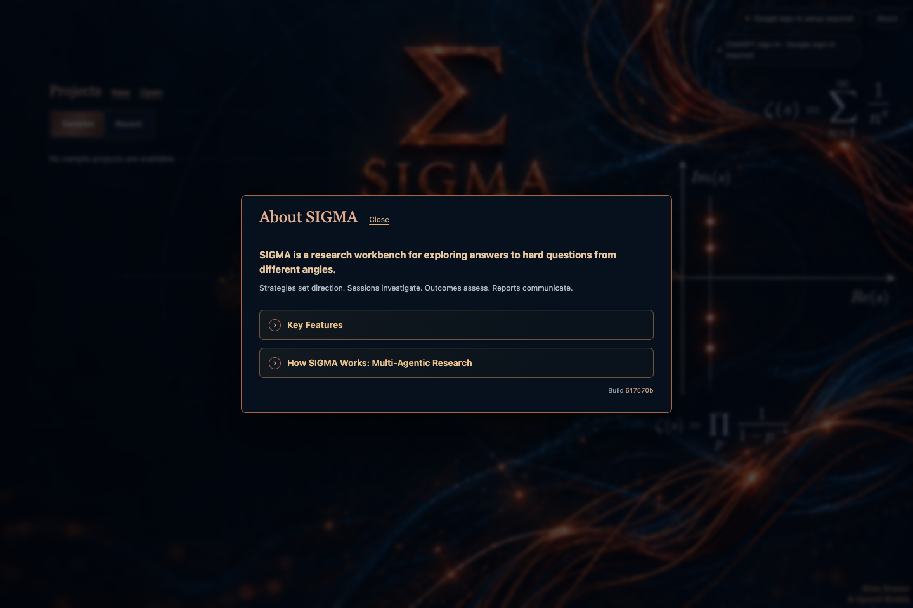 | 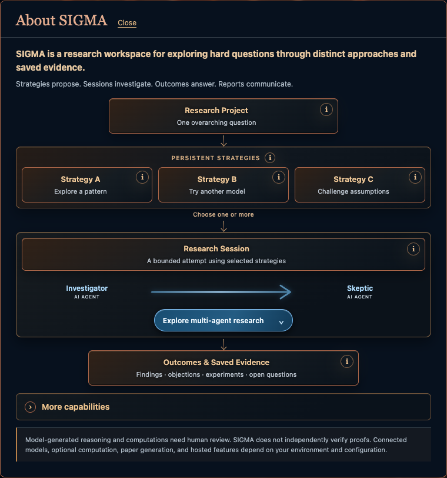 |
| 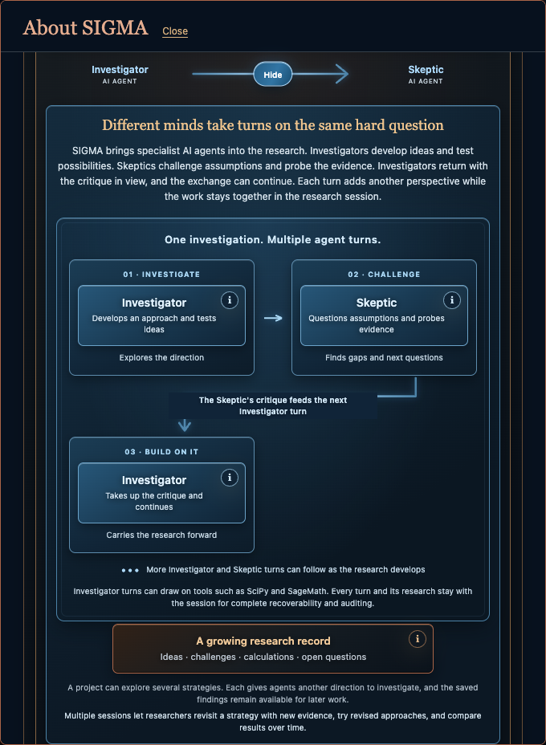 | 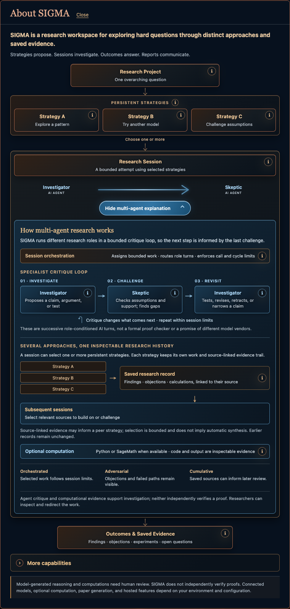 |
| 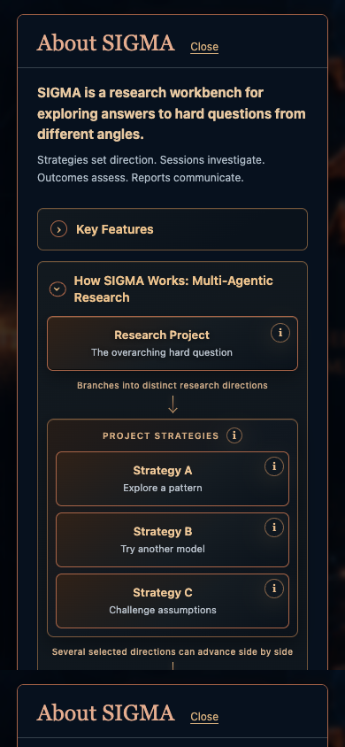 | 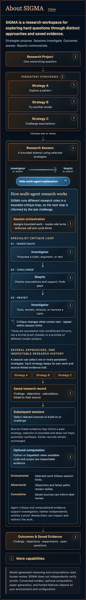 |

## Signed-out Home

| Before | After |
| --- | --- |
| 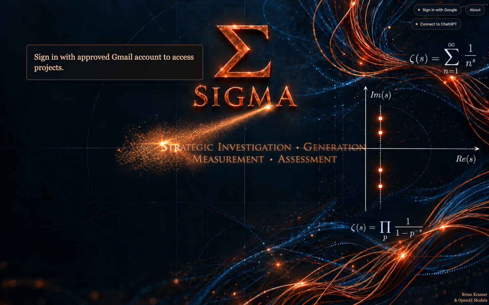 | 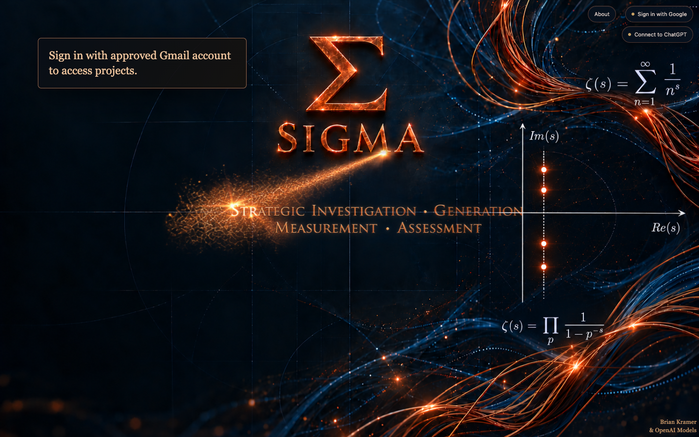 |
|  | 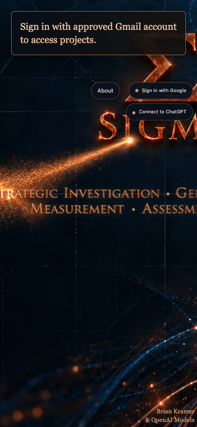 |

## Project header

The `?` action is now a labeled About pill in the second row under Difficulty. On mobile it moves into the grid with a 44px hit target.

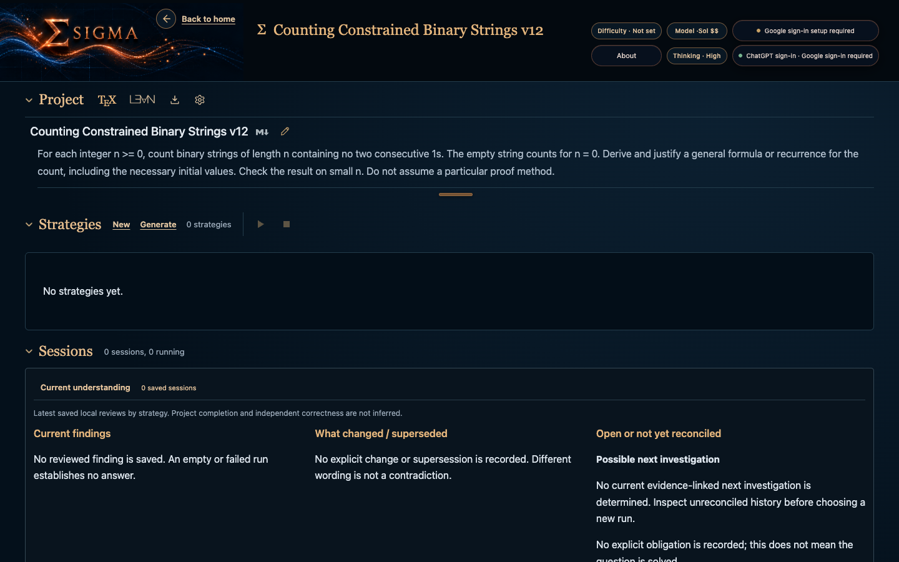

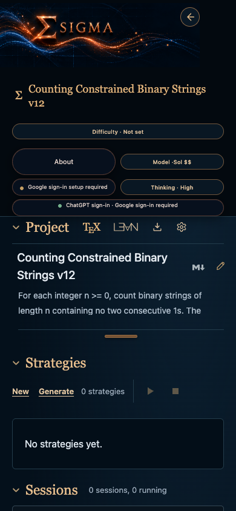

## Multi-agent explanation walkthrough

The expanded view uses a three-step Investigator → Skeptic → Investigator loop, a separate strategy-to-history illustration, and short orchestration, computation, and integrity notes. The arrows communicate successive role turns and selective evidence reuse; the copy avoids promises of independent model vendors, universal parallelism, or automatic synthesis. Hover explanations wait 500 ms so they do not cover the expansion control, while keyboard focus and touch remain immediate. The closed dialog stays compact; the expanded view uses more vertical room and scrolls when needed. At standard mobile heights, it retains the full-width content without horizontal overflow.

Full dialog captures at the tested widths: [desktop, 1440px](about-multiagent-expanded-desktop.png), [mobile, 390px](about-multiagent-expanded-mobile-390.png), and [mobile, 320px](about-multiagent-expanded-mobile-320.png). Closed overview captures: [desktop](about-multiagent-collapsed-desktop.png), [390px](about-multiagent-collapsed-mobile-390.png), and [320px](about-multiagent-collapsed-mobile-320.png).

The expanded session chapter on its own, so the explanatory detail is readable without opening the full-height capture:

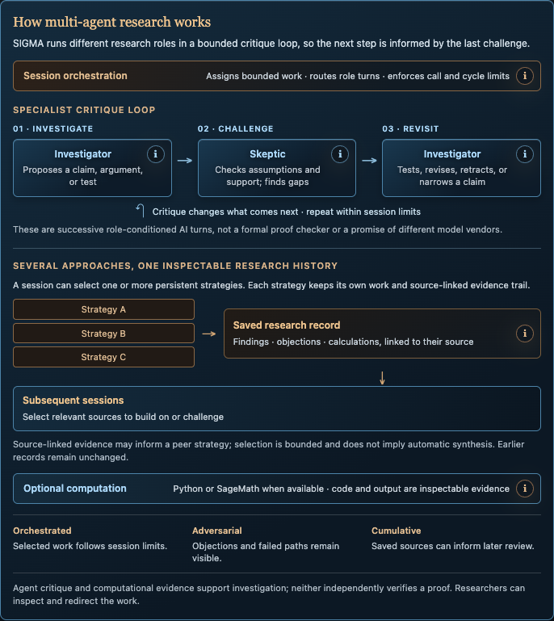

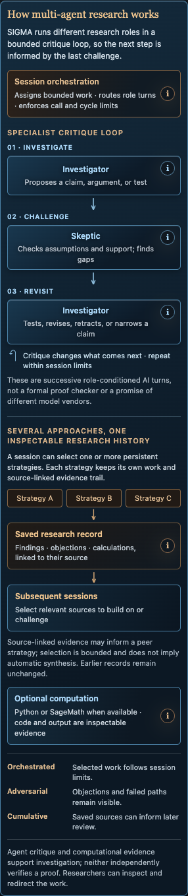

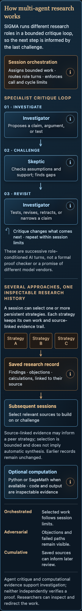
