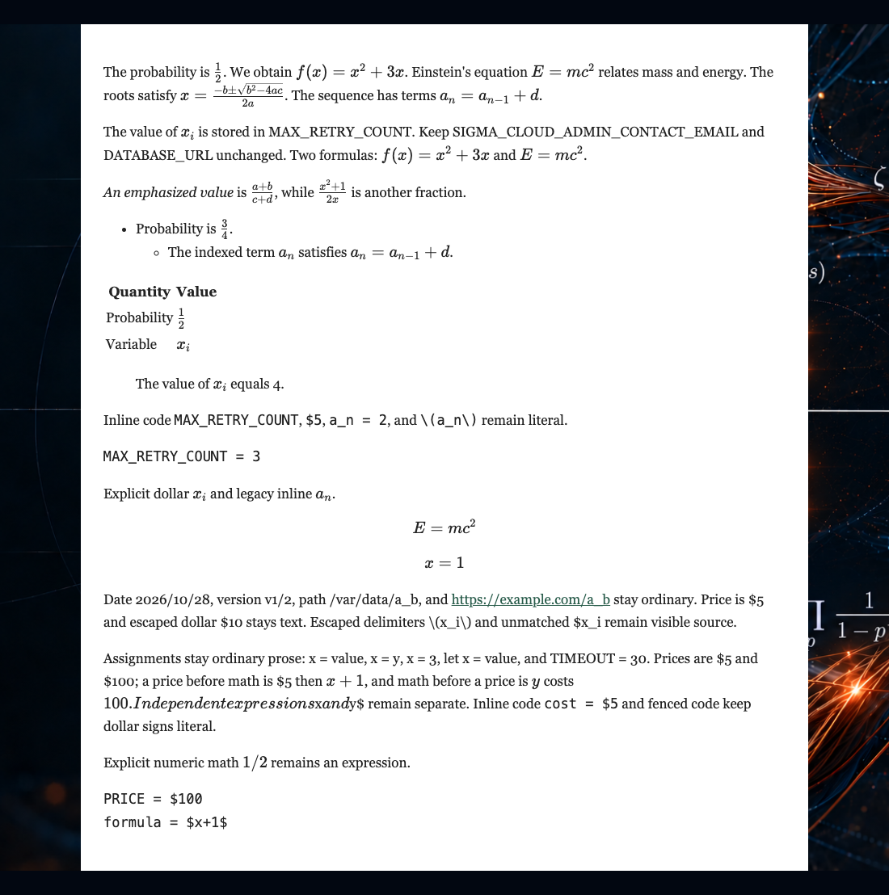
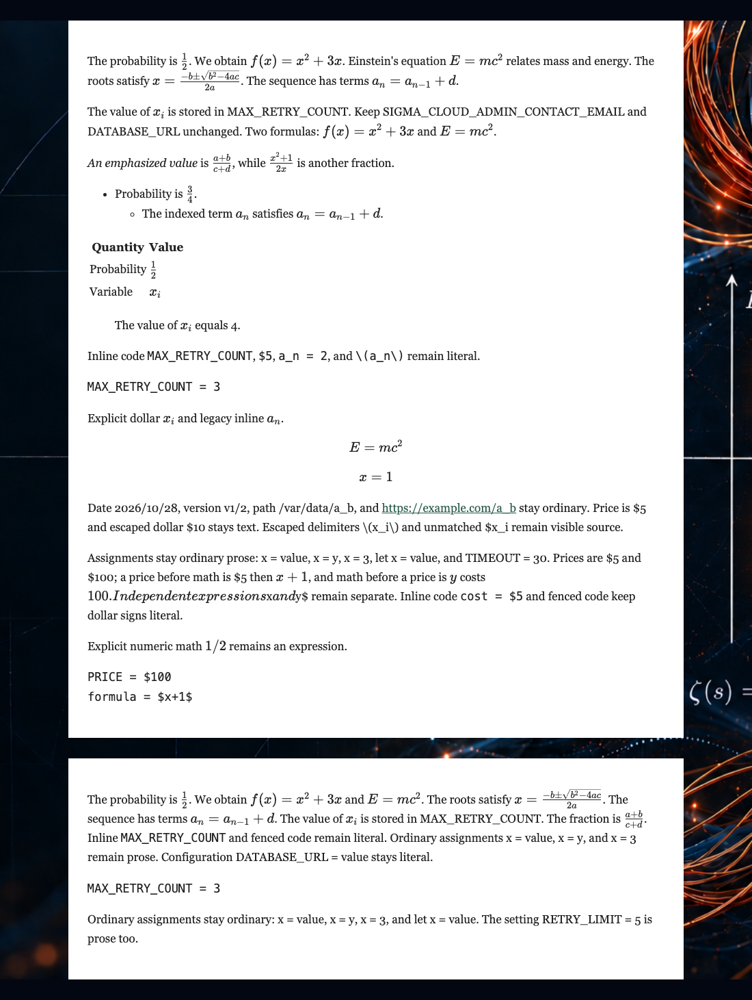

# T301 Markdown mathematics evidence

The `markdown-regression-output.md` file is the deterministic provider response
fixture verified through SIGMA's real `POST /api/projects/text/convert` route in
`tests/text_views.py`. The test checks the exact stored result, the prompt
instructions, one provider transport, and that the source project bytes remain
unchanged. The provider transport is mocked; this is not live AI verification.

`browser_checks/t301_markdown_math.py` imports the production
`frontend/src/RenderedMarkdown.tsx` component from the running Vite app and
renders both the API output fixture and a bare-notation input in real Chrome.
It checks the KaTeX TeX annotations for the expected formulas, as well as math
in prose, lists, a nested list, a GFM table, blockquotes, inline code and a code
fence. It also checks preservation of identifiers, dates, paths, URLs, currency,
and malformed or escaped delimiters.
Adversarial cases now include bare `x = value`, `x = y`, `x = 3`, and the
code-like `let x = value` form, a
configuration assignment, multiple `$5`/`$100` prices before and after explicit
math, separate `$x$` and `$y$` expressions, and dollar signs in inline/fenced
code. The browser check verifies literal rendered text alongside each KaTeX
annotation, including the expected count of 25 KaTeX spans for the shared
fixture and seven for bare source notation.





Run the browser check with the frontend development server on port 5193:

```sh
npm --prefix frontend run dev -- --port 5193
uv run --with playwright python browser_checks/t301_markdown_math.py
```

There were no paid or live provider calls. Live model judgment about ambiguous
source text remains unverified.
